# tern-plugin-omp-usage

Your omp usage limits, right above the omp composer's context bar in [Tern](https://stencil.so/tern):


## Quick start

1. In a terminal (or Tern's Preferences › Plugins › Install):

   ```sh
   tern plugin install github.com/jmazzola/tern-plugin-omp-usage
   ```

2. **Restart your omp sessions** when the toast says it's installed.
3. Click into an omp pane. Within a few seconds the line shows above the context bar (`2% ──── 1M`). Hover it for
   the card, press Alt+Shift+U for the quota details and Ctrl+Alt+U for the settings.

You need Tern with plugins on, and omp signed in to an account with limits (`omp usage` should list them) or an
[external quota source](#external-quota-sources). [Install](#install) has the details and what to do when it can't
set itself up.

## What it does

Tern's widget bar can show stats too, but it lives at the edge of the window. This sits right where you're already
looking while you work: above the composer, every time you glance down, without leaving the session.

- follows your model: the active model's provider (anything `omp usage` reports - Claude, Codex, Kimi, Gemini, Grok,
  Muse Code, …), switching within ~2 s of Alt+P, or a subagent's model while you're viewing its transcript. New
  providers and windows just show up. Or it shows every provider, or only the ones you pick, in your order.
- several accounts on one provider: all of them (`Claude dev.ops 5H … · a.k.chen 5H …`), only the one you pick, or
  combined into one set of windows (all in one, or by plan). Switch any of them off to leave it out.
- reads at a glance: a bar per window in its provider's colors, amber at 25% left, red at 10%. When a share changes,
  a comet runs the bar to its new level. Saved resets show as `+N` (`+NF` for Claude's Fable resets). Shares round
  down (99.6% reads 99%), and `<1%` means a little is left.
- [pace](#pace): when you're using a window up faster than its time runs out, the card says how fast and when it
  would run dry (`1.2× pace · empty ~2d`). **Show pace** can show it for every window, or turn it off.
- [honest about old numbers](#how-old-the-numbers-are): numbers older than 10 minutes fade and say how old they are
  (`as of 21m ago`), and after 30 minutes the line goes back to omp's own status. A window whose reset time has
  passed reads `reset` until new numbers come.
- puts what limits you first: on a Fable or Mythos model, the Fable weekly window leads the line
- stays readable: the line sits on a strip of Liquid Glass (or a solid one, or none), so the chat scrolling under the
  composer only shows through it softened
- a hover card that fits: you set how many rows it can take, and past that, accounts sum up instead of running off
  the screen
- each account's plan (`Ultra`, `Pro 200`) on its heading, wherever the provider says which plan it is; switch any of
  them off in the panel
- quota details (Alt+Shift+U): every account and window in full, in a view of its own
- [the widget bar](#widget-bar): a gauge that stays quiet until a window in the focused omp pane runs ahead of its
  pace, then warns (`Claude 1.4× pace`). Shares and resets are left to Tern's own usage widgets
- [alerts](#alerts), if you turn them on: one toast when a window falls to 25%, 10% or 0% left, and before a saved
  reset expires
- CLIProxyAPI and CPA Usage Keeper, if you use them: their accounts next to omp's own, and from Keeper, the tokens
  and API-equivalent cost each window has used and roughly what's left
- the same numbers in every pane, even though every omp session checks usage on its own clock
- [looks how you want](#display): four styles (Instrument, Blocks `▰▰▰▱`, Ring `◔`, Compact text), above the context
  bar, under it, or stacked a row per window at the composer's right or left. You pick which parts show, and
  whether shares say what's left or what's used
- a settings panel (Ctrl+Alt+U) for how the line looks and where it sits, what shows, the order, each provider's
  windows and colors, the line's background, pace, the widget bar and alerts
- installs from Tern and sets up its own omp extension
- updates itself like Tern does: an **Update omp Usage** pill in the widget bar, one click to see what's new and
  install it. Nothing pops up over your work.

## Install

You need Tern with plugins on (Preferences › Plugins), and either omp signed in to an account with limits (`omp
usage` should list them) or an [external quota source](#external-quota-sources).

1. **Install the plugin.** In Tern, go to Preferences › Plugins › Install, enter
   `github.com/jmazzola/tern-plugin-omp-usage` and click **Install**. Or from a terminal:

   ```sh
   tern plugin install github.com/jmazzola/tern-plugin-omp-usage
   ```

   A few seconds later it runs `omp plugin link` on its `omp/` folder, so omp loads the extension as its own plugin,
   `omp-usage`, straight from the plugin's folder. Updates reach omp the same way. With several Tern windows open,
   only one of them does it. Then it tells you:

   

   It runs the `omp` on Tern's `PATH`, or Tern's own omp when that one is missing or can't list plugins. If neither
   works, it says so instead, and Tern's log has the reason and the exact command to run:

   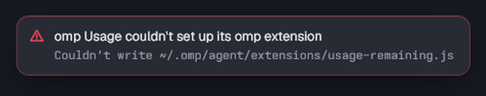

   From then on it's one of omp's plugins: `/extensions` or `omp plugin disable omp-usage` turns it off, `omp plugin
   enable omp-usage` turns it back on. omp Usage leaves the link however you set it. If you `omp plugin uninstall
   omp-usage` and want it back, run **omp Usage: Set up omp extension** from Tern's palette.

2. **Restart your omp sessions.** Click into an omp pane and the line shows up above `1% ──── 1M` (under it in
   Spine) within a few seconds.

### From a clone

To work on the plugin, clone the repo and link it instead, so Tern and omp load the files straight from your clone.
Use forward slashes in paths, even on Windows.

```sh
git clone https://github.com/jmazzola/tern-plugin-omp-usage.git
cd tern-plugin-omp-usage
tern plugin link .
```

Then have omp load the extension from the clone, and restart your omp sessions:

```sh
omp plugin link ./omp
```

Naming `omp/extensions/usage-remaining.js` under `extensions:` in `~/.omp/agent/config.yml` works too (a line
that's commented out doesn't count). An installed copy then skips linking its own, so omp never runs it twice.

A clone from before 0.5.0 may still be linked to its old `omp-usage` folder, which is gone now: run
`tern plugin link .` in the repo folder.

## The line and its card

Each provider gets its label, then each window gets its label, a bar filled to the share left, the share, and a
countdown to its reset. Saved resets come after as `+N` (`+NF` for Claude's Fable resets). While omp shows extension
statuses in its bar (it does unless you turned them off), any other statuses omp's extensions set go last. That's
the line as it comes: [Display](#display) changes its style, where it sits, which parts show, and whether shares
say what's left or what's used.

In the Spine chat style it sits just under the bar instead, on the composer's column, out of the way of omp's working
status:


Windows go shortest first, except while a Fable or Mythos model is active: then the Fable weekly window it draws on
leads, on the line and in the card:


A window at 25% left or less turns amber, and at 10% or less, red. When a share actually changes, the line prints
again while a comet runs the bar to its new level: in the provider's color when quota went down, green when it came
back. With Reduce Motion on (Tern's or the system's), nothing moves. Once a window's reset time has passed, it reads
`reset` (`5H reset`) until omp fetches its new numbers.

Tern's chats scroll under the composer, so the line sits on a strip of Liquid Glass: a faint tint with a lit rim and a
sheen, which softens the chat behind it without hiding it. **Line background** in the panel makes it Solid (opaque),
or Clear (no background at all). Here's the same moment Clear, then Glass:


Hover the line and after a beat the card opens: a row and a meter per window, its reset countdown and clock time, its
pace, then when each saved reset expires, and the other statuses. The last row names the shortcuts for the quota
details and the settings:


The card can take up to the number of rows you set in the panel (26 by default). Past that, accounts sum up to a row
each, and then the last few fold into one (`+4 more accounts · lowest 7D 5%`). With several providers or accounts,
each gets a heading in the title's color, and a bar in its provider's colors down the card's edge beside its rows
(there's a picture under [Settings](#settings)). A window whose reset has passed says so: `reset 1:41 AM · waiting
for new numbers`.

Each account's heading carries its plan as a gold pill (the title does, when the card shows a single account),
whenever its provider says which plan it's on. omp reports it for Claude (since omp 19), Codex, Z.ai, Kiro, Gemini
CLI, Muse Code and Copilot, and [CLIProxyAPI and Keeper](#external-quota-sources) report it for their accounts.
Plans read the way they're sold today: what omp calls Claude's `Max 5x` and `Max 20x` show as Max and Ultra, and
Codex's three Pro tiers as Pro 100, Pro 200 and Pro 500.

Where Keeper has an estimate, the tokens and API-equivalent value left go under the window's bar:


Clicking the line does nothing - it's drawn over omp's composer, and Tern doesn't give plugins clicks there. Use the
shortcuts, or the gauge in the widget bar.

### Pace

A window you're using up faster than its time runs out gets a pace row in the card and the quota details:
`1.2× pace · empty ~2d` means you've used it 1.2 times as fast as would last until its reset, and at that rate it runs
out in about two days, before it resets. It shows from 1.1× on. When, at that rate, it would already have run out
(the numbers are old), it says the rate alone (`1.5× pace`). In the first tenth of a window, or once a window is used
up, there's nothing. Pace never goes on the line. The [widget bar](#widget-bar) warns about it, though.

It's worked out from when omp observed the numbers, so old numbers don't skew it.

**Show pace** in the panel (or **omp Usage: Settings… › Show pace…**) picks which windows get the row:

| Show pace | What you see |
| --- | --- |
| **Off** | No pace rows, and no warning in the widget bar |
| **When ahead** (default) | A row only for a window at 1.1× or more, in the warning color. A window that keeps pace says nothing |
| **Always** | A row for every window. One that will outlast its time reads `0.4× pace · lasts past reset`, in the same quiet tone as its reset time. Between 1× and 1.1× it says when it would run out, still quiet; from 1.1× on it turns to the warning color |

### How old the numbers are

omp checks usage every few minutes, so numbers up to about 7 minutes old are normal. Past 10 minutes since omp
fetched them, they fade on the line and in the card, and say how old they are: in the card's title when everything it
shows is old, else under the provider that is, and in the quota details beside its heading.

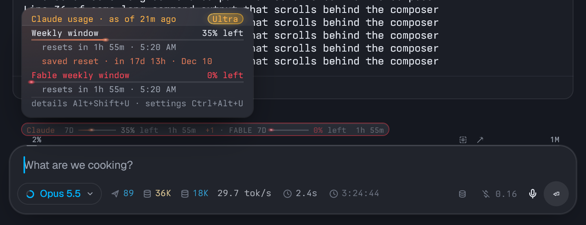

Past 30 minutes they're not shown at all, and the line falls back to the session's own status in omp's bar. Numbers
stay old when `omp usage` keeps failing (offline, an expired login), even while omp sessions keep running.

## Display

**Display** in the panel changes how the line looks and where it sits (from the palette: **Line style…**, **Line
position…**, **What the line shows…** and **Shares…** under **omp Usage: Settings…**). Until you pick something
there, the line is drawn as it always was.

### Style

How each window is drawn. Top to bottom, Instrument, Blocks, Ring and Compact:

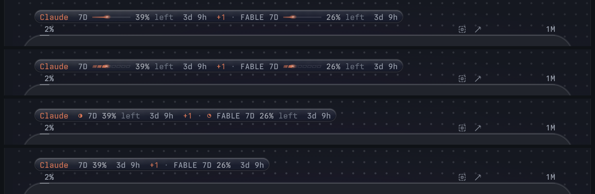

| Style | A window reads |
| --- | --- |
| **Instrument** (default) | `7D ━━━━━━━━ 40% left`: a slim bar filled to the share, with a lit tip |
| **Blocks** | `7D ▰▰▰▱▱▱▱▱ 40% left`: eight blocks (six with several providers on the line), filled one by one. One stays filled while anything is left |
| **Ring** | `◑ 7D 40% left`: a dial before the window, in quarter steps (`○ ◔ ◑ ◕ ●`), whichever is nearest |
| **Compact** | `7D 40%`: text only, without the bar or the word `left`. With Shares on Used it keeps the word (`7D 60% used`), so a bare share always means what's left |

Colors, warnings (amber at 25% left, red at 10%) and fading work the same in every style. When a share changes, the
comets run on Instrument's and Blocks' bars; Ring and Compact print the line again without them.

### Position

- **Above the bar** (default): over the context bar, where it has always been (in Spine, just under it).
- **Under the bar**: between the context bar and the input, in every chat style. The input moves down a line to make
  room, in every omp pane, so nothing jumps when focus moves. While Tern's agents tray is open, the context bar
  sits above the tray, and the line stays right under it: the tray's cards move down a line instead.
- **Stacked**: a block over the end of the chat, at the composer's **Right** (default) or **Left**, with a row per
  window and the columns lined up. It shows up to 4 rows; with more, the last row sums up the rest (`+2 more · lowest
  7D 58%`). The hover card opens from the same side.

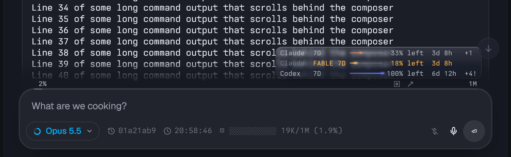

A provider with several windows is named on its first row and repeated, faintly, on the others, so every row starts
at the same column (an account, too). A stacked row takes one color (its window's warning tone), so the provider's
colors go to the bars. Whatever omp shows right above the composer (its working status, a progress row, an
extension's widget) moves up to stay clear of the block, so only the chat itself scrolls under it. In a pane
narrower than its longest row, the rows are cut off at the right (see [Troubleshooting](#troubleshooting)).

Above and Under the bar keep to one line. In a pane too narrow for it, the windows that don't fit are left out
whole, and three dots after the last one that fits say there are more (the card has them all). A pane too narrow
even for the first window's share gets a shorter line instead: the shares alone, without bars, countdowns or
names (`5H 62% · 7D 41% +1…`), so a share is the last thing a narrow pane loses.

The hover card never leaves its pane: where the pane has less room than the card needs, the card's text shrinks to
fit. A source's long note (a stale Keeper snapshot, a failed refresh) takes as many rows of the card as it needs.

### On the line

Switch any part of the line off: **Provider**, **Window** (`5H`, `7D`), **Bar**, **Share** (`40%`), **Countdown**,
**Saved resets** (`+1`), **Plan** and **Other statuses**.

- A window always keeps its bar or its share: the last of the two can't be switched off. Compact has no bar, so
  there it's the share.
- **Plan** is off until you turn it on. It puts each account's plan after its provider or account as a gold pill,
  like the card's.
- With **Other statuses** off, what omp's other extensions set stays in omp's own bar instead of moving up to the
  line.

The card and the quota details show everything either way.

### Shares

**Left** (default) says what's left of each window (`40% left`), **Used** what's gone (`60% used`): on the line, in
the card and in the quota details, and bars and dials fill to match. Used is always 100 minus what Left would show,
so the two add up: `>99% used` where Left reads `<1%`, and `100% used` at `0% left`. Warning colors, alerts and the
widget bar still go by what's left.

## Widget bar

Tern has its own AI usage widgets, and they already show each provider's share and when it resets. So omp Usage's
segment in the widget bar only says what they don't: whether you're using a window up too fast.

Most of the time it's just a gauge. While a window in the focused omp pane runs ahead of its [pace](#pace) (1.1× or
more), it turns amber and names the provider and the rate:

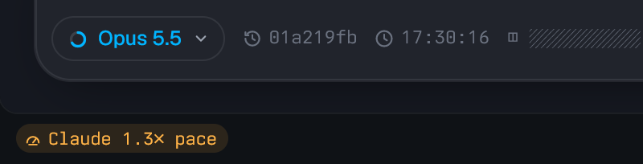

With several windows ahead, it names the one furthest ahead, and when two read the same, the one that would run out
first. It follows **Show pace**: set to Off, it never warns. While every window keeps pace, the gauge sits there
alone:

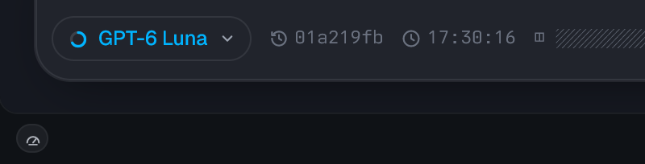

Clicking it opens the settings panel, or the quota details if you set it to (**Widget bar** in the panel).

Tern only shows plugin segments in its **Plugin segments** widget, which you have to place yourself (palette › **Edit
widgets…**), and the gauge shows there while an omp pane has focus.

## Alerts

Off until you turn them on: **Alerts** in the panel, or **omp Usage: Settings… › Alerts…**. Then a toast says when a
window falls to 25%, 10% or 0% left, once for each in a reset period, and when a saved reset expires within a day:

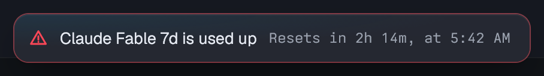

- Turning them on doesn't toast what's already low, only what crosses a threshold from then on.
- One toast for each, however many Tern windows are open. Several at once share a toast (`Also Claude 7d 24% left`).
- They watch every provider and account omp Usage has numbers for, shown on the line or not, as long as the numbers
  are less than 30 minutes old.

## Quota details

Every account and window in full, in a view of its own, with no row limit. Open it with:

- Alt+Shift+U (rebind `plugin.omp-usage.details`)
- the gauge in the widget bar, if you set it to open the quota details (see [Settings](#settings))
- **Quota details** at the end of the settings panel's bottom bar
- **omp Usage: Quota details** in the palette

It opens over the tab and takes the keyboard. To close it, click outside it, click **Close**, or press Ctrl+Shift+W
(Tern's **Close block**). Esc doesn't close it, though Tern's footer under it says so (see
[Troubleshooting](#troubleshooting)). Drag its header to keep it around. **Settings** swaps it for the settings panel
(and the panel's **Quota details** swaps right back).

Each provider or account gets a heading in its own color, then a box per window, side by side while they fit: the
share, a bar in the line's colors, and its resets, pace and notes. A window running low is ringed amber, and red when
it's nearly empty. Numbers older than 10 minutes get their age beside the heading. It always shows the same
providers, accounts and windows as the line.

Each account's heading also gets its plan as a chip when its provider names one. Here are Claude and Codex with All
providers, Claude's weekly window running ahead of its pace and Codex's numbers 14 minutes old:


With a [CLIProxyAPI or Keeper](#external-quota-sources) source, the heading also says when the account's numbers
were observed, notes call out a stale or failing source, and windows Keeper has usage for get **Observed usage** and
**Estimated remaining** under the bar. Here it is with sample data shaped like a Keeper source's:


## Settings

Open the panel with:

- Ctrl+Alt+U (rebind `plugin.omp-usage.panel`)
- the gauge in the widget bar, unless you set it to open the quota details instead (**Widget bar** below)
- **Settings** in the quota details
- **omp Usage: Settings panel** in the palette

Changes apply right away, in every window.

| Section | What it does |
| --- | --- |
| Preview | The line and its card, drawn for the last omp pane you used, the line on the background you picked. Under it, **Card height**: 16 to 50 rows, 26 by default. An estimate under a bar takes a row; everything else Keeper reports goes in the quota details. Then **Line background**: Glass (default), Solid, or Clear, which the preview's line takes as you click. Then **Show pace**: Off, When ahead (default), or Always (see [Pace](#pace)) |
| Display | How the line looks and where it sits (see [Display](#display)). **Style**: Instrument (default), Blocks, Ring or Compact. **Position**: Above the bar (default; in Spine, under it), Under the bar, or Stacked (a block over the chat, a row per window, up to 4; past that the last row sums up the rest), at the composer's **Right** (default) or **Left**. **On the line**: provider, window, bar, share, countdown, saved resets, plan (a gold pill, off by default) and other statuses; a window keeps its bar or its share. **Shares**: Left (default) or Used, on the line, the card and the quota details |
| Show | **Current model** (default), **All providers** (countdowns move to the card), or **Selected providers**. When there's no quota data for them, the line falls back to the focused session's own status |
| Providers | Pick a row up by its grip, then click where it goes. Click a window to hide or show it everywhere. The switch adds the provider to Selected. A provider or account whose plan is known shows it as a gold pill beside its switch: click the pill to leave that plan out of the card and the quota details (it fades and is struck through), again to show it. With several accounts, each one gets its own row: grip, name (click it to show only that account, again for all), windows, plan, and a switch that takes it off the line, the card and the quota details. A chip next to the provider says what's showing, with a button for the next option: `all 8 accounts` with **combine**, `combined · 10 accounts ✕` with **by plan**, `by plan · 2 Max, 4 Pro, 4 Ultra ✕` (or `by plan · 6 with 5H, 4 without ✕`) with **all in one**, or `only dev.ops ✕`. Grouped by windows, each account's row is tagged with its group (`5H`, `no 5H`) |
| Colors | A preset, a named alternative (Ember, Sunset, Moss, Ocean, Orchid, Slate, Theme accent), or **Custom…** hex colors (`#d97757`, or two: `#9aa7b4, #5b8def`). A custom color that's nearly white gets a darker shade in the light theme, and one that's nearly black a lighter one in the dark theme, so it never vanishes into the card |
| Widget bar | What a click on the gauge in the widget bar opens: **Settings panel** (default) or **Quota details** (see [Widget bar](#widget-bar)) |
| Alerts | **Toast when a window runs low**: Off (default) or On (see [Alerts](#alerts)) |
| Updates | Status, **Check for Updates** or **Download Update**, and how often to check (see [Update](#update)) |

External quota sources are set up in a file, not the panel (see [External quota sources](#external-quota-sources)).
Their accounts show up under Providers like omp's own.


Further down, the Widget bar and Alerts sections, here with alerts on:

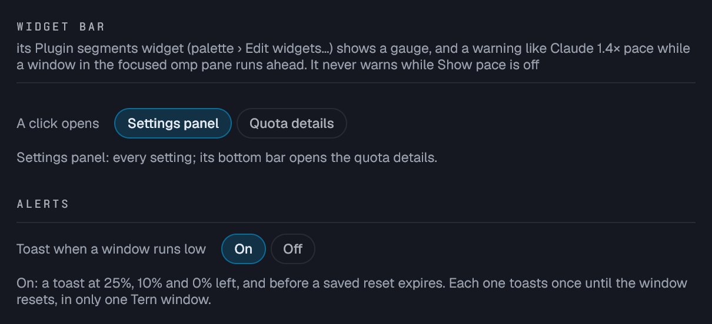

Prefer the keyboard? **omp Usage: Settings…** in the palette has all the same options as menus. **Plans…**,
**Reorder providers…** and **Stacked at…** only show when there's something to pick or reorder.

**All providers**, one after another. Each provider's heading carries its plan, with a bar in its colors beside its
rows:

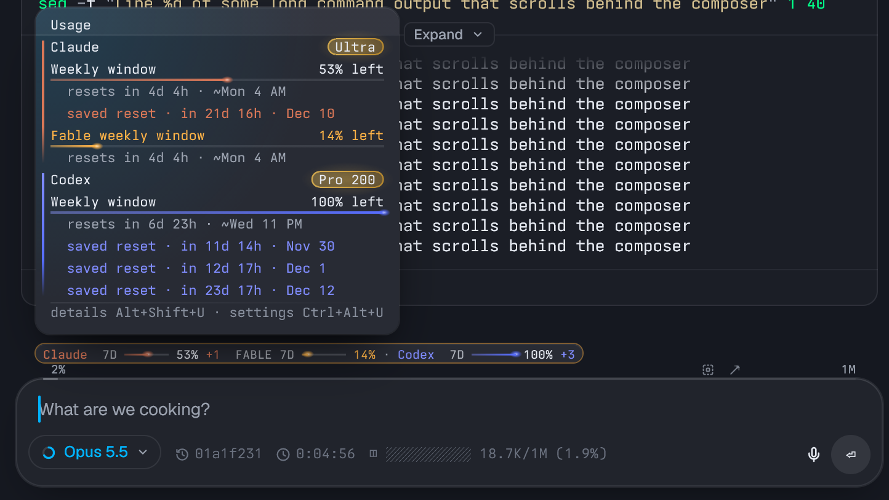

**Selected providers**, here Codex and Muse while an Opus model is in use:


**Colors**, with Claude on Sunset and Codex on a custom `#22d3ee, #a78bfa`:

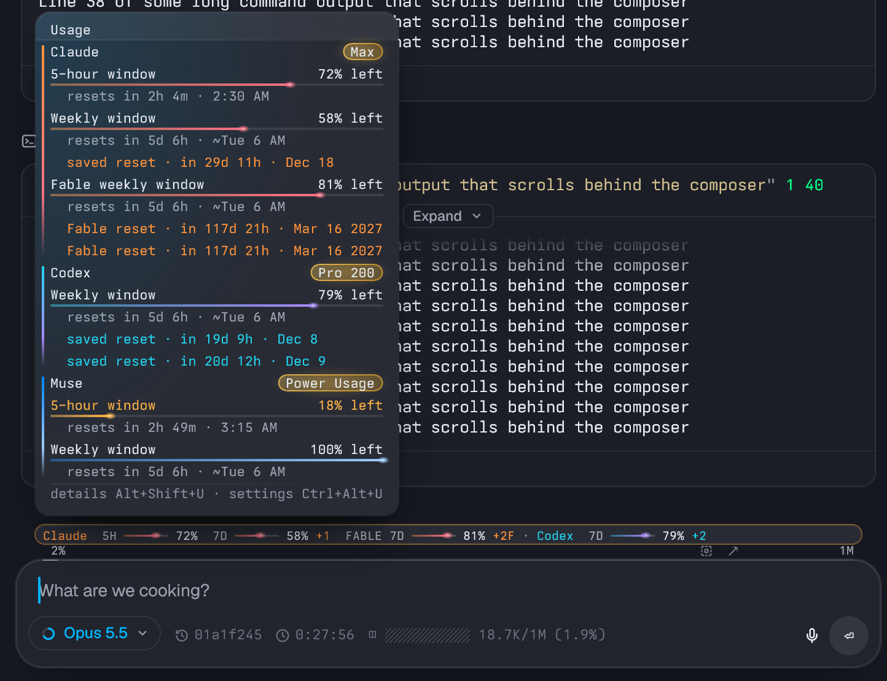

### Several accounts

Accounts go by the part of their email before the `@`. Seats that share one add their domain (`claude-team@lumen`,
`claude-team@pinegg`).

Here are ten Claude accounts, two of them switched off. The line starts with the first account. The card shows the
first accounts' windows in full for as long as they fit your card height, each under its heading with its plan and a
bar in Claude's colors, then sums up each of the others in a row, and with even more, folds the last of those rows
into one:


In the panel, click an account's name to show only that one (click it again, or the chip next to the provider, to go
back to all of them). The switches take accounts off the line and the card:


That gives the line room for all of that account's windows, and the card sums up the others in a row each:


**Combine** shows all of a provider's accounts as one: each window's share is the average of the accounts that have
it, its reset is the soonest one, and its saved resets are all of theirs added up. A window only some of the accounts
have says how many. An account with no current numbers (a source that went stale, say) is left out of the averages,
and a note names it:


**By plan** groups the accounts by the plan their provider says they're on. Here, 2 accounts are on Max, 4 on Pro and
4 on Ultra, which has no 5-hour window:

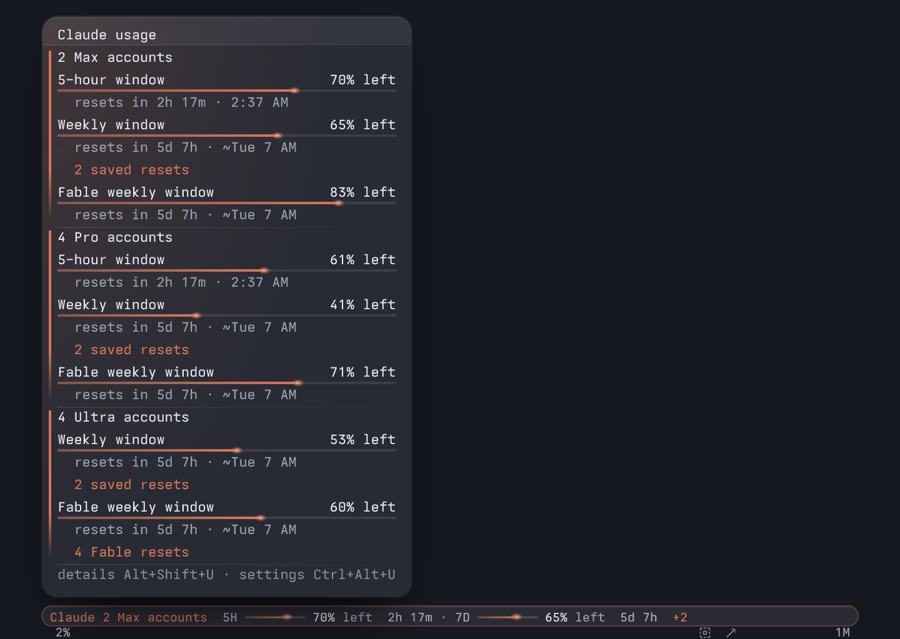

When any account doesn't name its plan (Kimi and Antigravity never do, nor Claude before omp 19), the accounts with
the same windows go together instead (`6 accounts with a 5-hour window`, `4 accounts without a 5-hour window`).

In the panel, the chip says how they split, and each account's row keeps its plan beside its switch (a row whose
plan is off, or that was grouped by windows, gets a tag with its group instead):

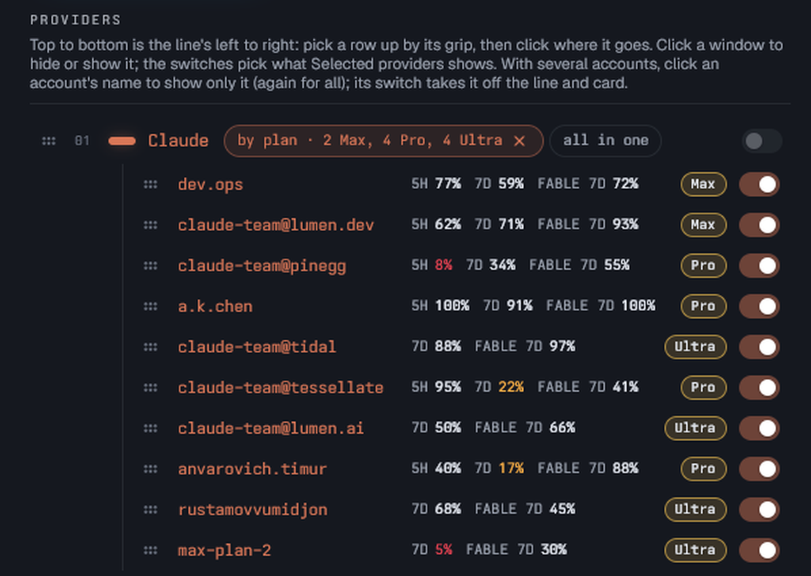

Combining only averages shares. Tokens, costs and estimates are never averaged or added up across accounts (that
would be meaningless across different plans), so they only show with All accounts or a single account picked.

Several providers can each have several accounts. With All providers, every account shown in full gets a heading
naming its provider, its plan, and a bar in its provider's colors; here Codex's second account no longer fits the
card height, so it sums up to one row:


To reorder, pick an account (or a provider) up by its grip. It lifts, every spot it can go opens up, and a click drops
it there. Its grip turns into a cross, which puts it back:


**omp Usage: Settings… › Provider accounts…** does the same thing from the palette, as menus:


## External quota sources

On top of omp's own accounts, omp Usage can show the accounts behind two proxies, each source as its own provider
and account pool (`Codex@dashboard`):

- [CLIProxyAPI](https://github.com/router-for-me/CLIProxyAPI) (CPA): quotas read through its management API, with
  each account's plan
- [CPA Usage Keeper](https://github.com/Willxup/cpa-usage-keeper): quotas from its cache. Keeper also records every
  request CPA serves, so for a window with usage it knows the tokens and API-equivalent cost spent so far, and omp
  Usage estimates what's left from that.

Set them up in `~/.omp/agent/usage-sources.json` and restart your omp sessions. Nothing changes until that file
exists. The settings, model mappings, what each source can and can't give you, and what the views show are all in
[docs/quota-sources.md](docs/quota-sources.md).

## Update

The plugin checks its repo every 6 hours (or Hourly, Daily, Weekly, or Off in the panel): a clone checks its remote,
and an installed copy checks a copy of the repo it keeps in its data folder. When there's a new version, a toast says
so once, and an **Update omp Usage** pill sits in the widget bar until you deal with it:


The pill and the gauge are plugin segments, so they only show while the widget bar has its **Plugin segments** widget
(palette › Edit widgets…).

Click the pill (or **What's New**, or **Check for Updates**) for the update card: the version that's out, the one you
have, and every new commit in full.


| Button | What it does |
| --- | --- |
| **Download Update** | Brings the plugin (and an installed copy's omp extension) up to date and reloads it. The toast says if omp sessions need a restart |
| **Skip This Version** | Hides the pill until the next plugin change |
| **Not Now** | Closes the card. The pill stays |

A click outside the card closes it too, and so does Ctrl+Shift+W (Tern's **Close block**). Esc doesn't, though Tern's
footer under the card says so (see [Troubleshooting](#troubleshooting)). The card takes the keyboard while it's open,
so nothing you type reaches the omp pane behind it.

**Restart your omp sessions after an update** that changes the omp extension. A running session keeps the extension
it started with, and once the extension's files change it stops writing the numbers every pane reads, so the line
fades and then falls back to omp's own status until you do.

Open settings panels step aside while the update lands, so nothing flashes half-drawn:


When omp's link to the extension has to change, it tells you. That's the first time 0.7.0 or later loads after an
update (which also deletes the `~/.omp/agent/extensions/usage-remaining.js` loader that 0.5.2 to 0.6.x wrote), or
after the plugin's folder moved:

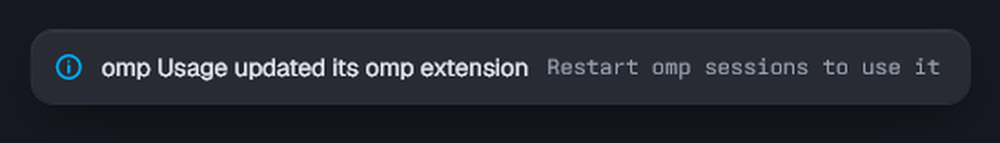

The panel's Updates section says where things stand:

| It says | Meaning |
| --- | --- |
| **omp Usage 0.8.0 is up to date** · Checked 5m ago | The last check worked and found nothing new. It only says up to date after a check that worked |
| **omp Usage 0.8.1 is available** · You have 0.8.0 | An update is waiting: **Download Update** or **What's New** |
| **Skipped 0.8.1** | You skipped that version. **Check for Updates** offers it again |
| **Couldn't check for updates**, with the reason | The last check failed: offline, no git, no upstream. Try again in a moment |
| **This clone has commits of its own** | Your clone has commits the repo doesn't. Merge by hand: `git pull` |
| **Finishing the update to 0.8.1** | An installed copy whose update was cut short (Tern closed, a reload) finishes it as soon as it can |

And the toasts an update can bring: **omp Usage updated to X** when it's done, **omp Usage didn't update** with the
reason when nothing changed, **omp Usage finished updating to X** when an update that was cut short finishes on the
next load, and **omp Usage couldn't finish updating to X** with the reason when that fails (the next load or check
tries again). **omp Usage is up to date** answers a check you asked for.

A few things to know:

- commits that only touch the README, `docs/`, `.omp/`, `.github/`, `tests/` or `package.json` don't count. They
  don't light the pill, and come along with the next real update.
- a merged pull request shows up as one entry (its merge), not every commit in it
- it never merges or rebases your work in a clone. With local commits, or edits in the way, update by hand:
  `git pull`, then `tern plugin reload`.
- an installed copy updates safely: it writes the new files beside the old ones first and `plugin.toml` last, so a
  copy cut short still says its old version and finishes the update on its next load. It only copies the plugin's
  own files, deletes the ones the update removed, and doesn't download the whole repo again after `git gc`.
- updates need git on your `PATH`, installed copies included
- an installed copy updates from whatever repo its `upstream` file names, read on every check. A fork puts its own
  URL there, and updates leave that file alone.

## Turn it off

| To | Installed | From a clone |
| --- | --- | --- |
| Turn the plugin off | Preferences › Plugins | `tern plugin unlink omp-usage`, or Preferences › Plugins |
| Turn it back on | Preferences › Plugins | `tern plugin link .` from the repo folder |
| Turn just the extension off | `omp plugin disable omp-usage` (or `/extensions` in omp), then restart omp | The same, if you linked it. Otherwise delete its line from `~/.omp/agent/config.yml` |
| Remove it | `omp plugin uninstall omp-usage`, then `tern plugin remove omp-usage`, and restart omp | `omp plugin uninstall omp-usage` (or delete the extension's line from `~/.omp/agent/config.yml`), then `tern plugin unlink omp-usage`, and restart omp |

## Troubleshooting

| Symptom | Check |
| --- | --- |
| `tern plugin list` isn't `ready` | It prints the error. Tern's log is at `%LOCALAPPDATA%\Tern\Logs\tern.log` |
| No line | The focused pane is omp; its provider has limits; your omp sessions were restarted after installing or updating; `omp plugin list` shows `omp-usage` enabled (if not, run **omp Usage: Set up omp extension** from the palette), or `extensions:` in `config.yml` names it on a line that isn't commented out |
| The line faded and says `as of 25m ago`, or went back to omp's own status | omp hasn't fetched new numbers: run `omp usage` to see why (offline, an expired login). Right after an update, restart your omp sessions: sessions started before it stop writing the numbers |
| `omp Usage couldn't set up its omp extension` | Tern couldn't run `omp plugin`: omp has to be on the `PATH` Tern started with, or be the omp Tern manages. Tern's log has omp's reason and the `omp plugin link …` command to run yourself |
| All/Selected only show the current model, or panes show different numbers | No omp session has written the numbers for 30 minutes. Start or restart an omp session |
| An omp pane over SSH or in WSL shows different numbers, or no line | That's on purpose: the numbers omp Usage reads are this computer's, so those panes show their own omp's status instead. Set the extension up in the omp there (`omp plugin link ./omp` in a clone) and keep omp's extension statuses on (`statusLine.showHookStatus`, on by default) |
| The line says `usage cache too big to read` | The file the extension writes is over 1 MiB (very many accounts and models). Restart your omp sessions: an up-to-date extension writes it much smaller |
| The hover card is cut off at the top of a short pane | It opens above the line, and Tern doesn't tell plugins how tall a pane is. Open the quota details (Alt+Shift+U), or pick a smaller **Card height** |
| A stacked line's rows are cut off, ending in `…` | The pane is narrower than the block's longest row. Tern doesn't tell plugins how wide a pane is, so Stacked can't fall back to one line there. Widen the pane, switch some parts off (**On the line**), pick **Compact**, or pick another **Position** |
| The line ends in three dots and some windows are missing | The pane is narrower than the line, so the windows that don't fit are left out (see [Position](#position)). Hover for the card, widen the pane, pick **Compact**, or switch some parts off (**On the line**) |
| The line shows only shares (`5H 62% · 7D 41%…`), no bars or names | The pane is too narrow for the first window with its bar, so the line shows its short form (see [Position](#position)). Widen the pane, or hover for the card |
| The hover card's text is small | The pane has less room than the card needs, so the card shrinks to stay inside it. Widen the pane, or open the quota details (Alt+Shift+U) |
| A stale or failed source's long note isn't in its warning color in the hover card | An omp session started before this update wrote the note in two parts, without saying what it is. The card joins the parts again; restart your omp sessions for the color |
| The stacked block covers the end of the chat | That's where Stacked sits: over the chat, at the composer's edge. Pick the other side, or **Above the bar** or **Under the bar**, which take a line of their own |
| Other extensions' statuses are back in omp's bar | **Other statuses** (Display › On the line) is off: the line doesn't draw them, so omp does |
| omp's usage text shows in other omp panes' bars | omp shows extension statuses in every pane, and omp Usage hides its own there, since the line shows it better. Tern's styles can't tell panes apart, so while any omp pane needs that text as its fallback (over SSH, in WSL, a model with no numbers), it shows in every pane |
| The session cost stays in omp's bar while other segments drop out | That's omp Usage's `bar.css`: Tern cuts the session cost before any status segment, so with a long status line (the `full` preset) it would never show. Keeping it makes Tern drop the lowest-priority segments instead. The same sheet styles the Update omp Usage pill and centers the gauge in its chip |
| The line stopped after an omp or Tern update | omp may have renamed something the plugin reads. Ask omp to fix `omp-usage` |
| No plan on Claude's heading | omp reports Claude's plan since 19.0. Update omp and restart your omp sessions |
| On a Fable model, the Fable window doesn't lead | An omp session started before you updated omp Usage still runs the old extension. Restart your omp sessions |
| No pace in the card | With **Show pace** on **When ahead**, a window under 1.1× has nothing to say: pick **Always** to see every window's pace. Either way there's none in the first tenth of a window, once it's used up, or when omp gives no length or reset time for it. Or **Show pace** is **Off** |
| No alert toasts | Alerts are off by default (**Alerts** in the panel). They toast only crossings, not what was already low when you turned them on, and only numbers less than 30 minutes old |
| Clicking the line does nothing | That's expected: Tern doesn't give plugins clicks on omp's composer. Use the shortcuts, or the gauge in the widget bar |
| Alt+Shift+U or Ctrl+Alt+U does nothing | Another binding took it. Bind `plugin.omp-usage.details` or `plugin.omp-usage.panel` to something else |
| Esc doesn't close the quota details or the update card | Tern's footer under them says `press esc to close`, but Tern passes no keys to a plugin's view and keeps Esc for itself, so the plugin can't act on it. Click outside, use **Close** or **Not Now**, or press Ctrl+Shift+W (Tern's **Close block**, or whatever you bound `close_pane` to) |
| No update pill, or no gauge | Add the **Plugin segments** widget to Tern's widget bar (palette › Edit widgets…), or use the panel's Updates section. Checks might also be Off. The gauge only shows while an omp pane has focus |
| The gauge in the widget bar never warns | It only warns while a window in the focused omp pane is at 1.1× its [pace](#pace) or more, and never while **Show pace** is Off |
| `omp Usage can't check for updates` | It needs git on `PATH`; a clone needs a branch tracking a remote, and an installed copy needs its `upstream` file naming the repo (`https://github.com/jmazzola/tern-plugin-omp-usage.git`). The toast gives the reason |
| `omp Usage can't tell which version it is` | The repo its `upstream` file names has no commit at the installed version. A fork has to put its own URL in `upstream` |
| A clone stopped loading after an update | It's still linked to the old `omp-usage` folder, which is gone. Run `tern plugin link .` in the repo folder |
| Edits to the plugin's `.luau` files don't show | `tern plugin reload` |

Don't edit Tern's `settings.json` from PowerShell: it adds a BOM, and Tern falls back to its defaults. For external
quota sources, see [their troubleshooting](docs/quota-sources.md#troubleshooting).

## How it works

The parts, the cache every pane reads, the tests, and what it's been tested with: [docs/development.md](docs/development.md).
