# tern-plugin-omp-usage

Your omp usage limits, just above the omp composer's context bar in [Tern](https://stencil.so/tern):

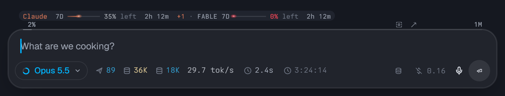

In the Spine chat style it sits just below the bar instead, on the composer's column, clear of omp's working status:

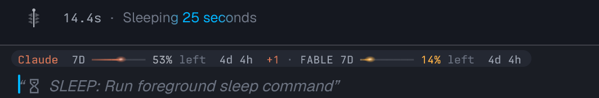

Hover it for each window's meter, reset time and saved resets:

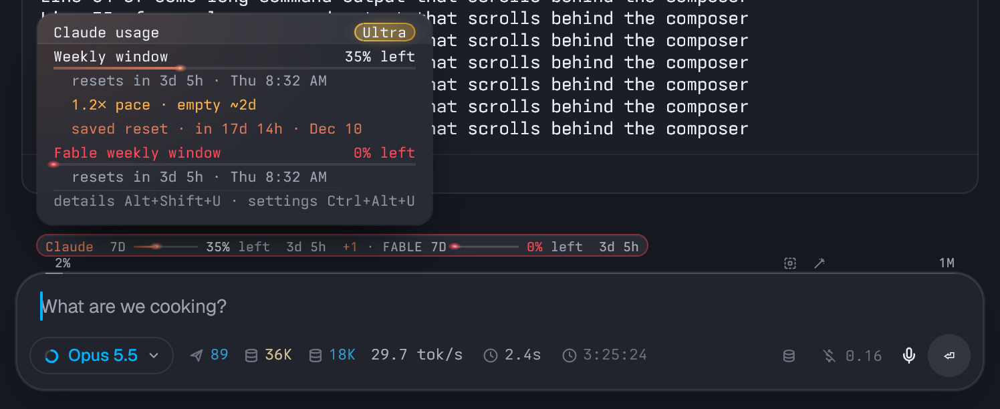

- **Follows your model.** Shows the active model's provider (anything `omp usage` reports: Claude, Codex, Kimi,
  Gemini, Muse Code, …) and switches within ~2 s of Alt+P, or to a subagent's model while you view its transcript.
  New providers and windows show up without changes here.
- **Or every provider**, or the ones you pick, in your order.
- **Several accounts** for one provider: all of them, each named once (`Claude dev.ops 5H … · a.k.chen 5H …`), only
  the one you pick, or **combined** into one set of windows (or **by plan**). Switch any account off to leave it out.
- **Reads at a glance.** Each window gets a bar in its provider's colors, amber at ≤25% left, red at ≤10%. When a
  share changes, a comet runs the bar to its new level. Saved resets show as `+N` (`+NF` for Claude's Fable resets).
- **A hover card that fits.** You set how many rows it may take; past that, accounts sum up to a row each, then fold
  into one.
- **Quota details** (Shift+Alt+U): every account and window in full, in a view of their own.
- **CLIProxyAPI and CPA Usage Keeper**, if you use them: their accounts' quotas next to omp's own, with each
  account's plan, and from Keeper the tokens and API-equivalent value each window has used and likely has left.
- **The same in every pane.** omp sessions each check usage on their own clock; every pane shows the newest
  numbers any of them got.
- **Settings panel** (Ctrl+Alt+U) for what shows, the order, each provider's windows and colors.
- **Installs from Tern**: Preferences › Plugins › Install, or `tern plugin install`; it sets up its omp extension
  itself.
- **Updates itself** like Tern does: an **Update omp Usage** pill in the widget bar, one click to see what's new
  and install it. Nothing pops up over your work.

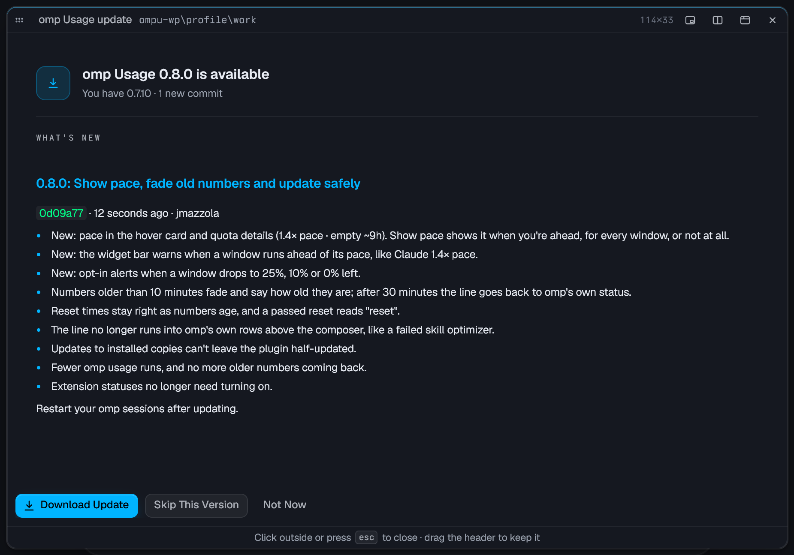

## Install

You need Tern with plugins on (Preferences › Plugins), and either omp signed in to an account with limits
(`omp usage` should list them), or an [external quota source](#external-quota-sources).

1. **Install the plugin.** In Tern's Preferences › Plugins › Install, enter
   `github.com/jmazzola/tern-plugin-omp-usage` and click **Install**. Or, from a terminal:

   ```sh
   tern plugin install github.com/jmazzola/tern-plugin-omp-usage
   ```

   Within seconds it runs `omp plugin link` on its `omp/` folder, so omp loads the extension as its plugin
   `omp-usage`, from the plugin's folder, and updates reach omp too. Then it says so:

   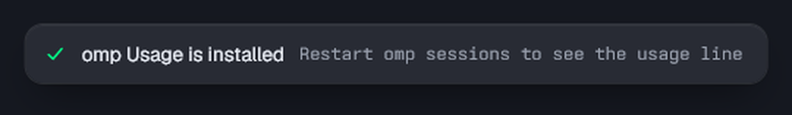

   If it can't (omp isn't on Tern's `PATH`, say), it says that instead, and Tern's log has why and the command to
   run:

   

   omp then lists it with its other plugins: `/extensions` or `omp plugin disable omp-usage` turns it off,
   `omp plugin enable omp-usage` back on. omp Usage leaves the link as you set it; after `omp plugin uninstall
   omp-usage`, run **omp Usage: Set up omp extension** in Tern's palette to link it again.

2. **Show extension statuses** in omp's bar, where the plugin reads the line. Either:

   ```yaml
   # ~/.omp/agent/config.yml
   statusLine:
     showHookStatus: true
   ```

   or, with `preset: custom`, add `status` to `leftSegments`.

3. **Restart omp sessions.** Click into an omp pane and the line appears above `1% ──── 1M` (below it in Spine)
   within seconds.

### From a clone

To work on the plugin, clone the repo and link it instead; Tern and omp then load the files from your clone. Use
forward slashes in paths, even on Windows.

```sh
git clone https://github.com/jmazzola/tern-plugin-omp-usage.git
cd tern-plugin-omp-usage
tern plugin link .
```

Then have omp load the extension from the clone, and do steps 2 and 3 above:

```sh
omp plugin link ./omp
```

Loading it from `~/.omp/agent/config.yml` (`extensions:` naming `omp/extensions/usage-remaining.js`) works too; an
installed copy then doesn't link its own, so omp never runs it twice.

> [!WARNING]
> **The `omp-usage` folder is deprecated.** Since 0.5.0 the plugin is the repo itself. Clones linked to
> `…/tern-plugin-omp-usage/omp-usage` (the old install) link the repo folder by themselves when they update to 0.5.0,
> and a toast says so:
>
> 
>
> If it couldn't, a toast says where to run `tern plugin link .` yourself:
>
> 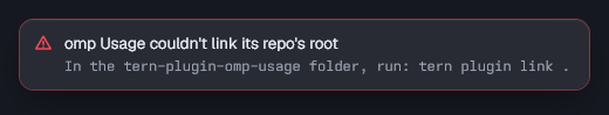
>
> The folder goes away in a later release, after which a clone still linked to it stops loading. `tern plugin list`
> shows which folder yours uses.

## The line and its card

The line lists each provider it shows, then for each window its label, a bar filled to the share left, the share and
its reset countdown, then saved resets: `+N`, or `+NF` for Claude's Fable resets. Other statuses omp's extensions set
come last. A window at 25% left or less turns amber, at 10% or less red. When a share changes, the line prints again
while a comet runs the bar to its new level: in the provider's color when quota went down, green when it came back.
Reduce Motion (Tern's or the system's) keeps it all still.

Hover the line and, after a beat, its card opens: a row and a meter per window, its reset countdown and clock time,
each saved reset's expiry date, and the other statuses. The card's last row names the shortcuts for the quota details
and the settings. The card takes at most the rows you set in the panel (26 by default): past that, accounts sum up to a
row each, then the last of those fold into one (`+4 more accounts · lowest 7D 5%`).

For a [CLIProxyAPI or Keeper](#external-quota-sources) account, the card also shows its plan as a pill on its heading,
and, where Keeper has an estimate, the tokens and API-equivalent value a window has left, under its bar:

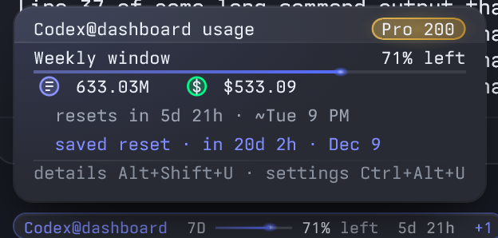

The line itself takes no clicks: it's drawn over omp's composer, where Tern gives plugins no click events. Use the
shortcuts, or `usage` in the widget bar.

## Quota details

Every account and window in full, in a view of their own, with no row limit. Open it with:

- **Shift+Alt+U** (rebind `plugin.omp-usage.details`);
- **usage** in the widget bar: Tern shows plugin segments only in its **Plugin segments** widget, which you place
  yourself (palette › **Edit widgets…**), and `usage` shows there while an omp pane has focus;
- **Quota details** at the end of the settings panel's bottom bar;
- **omp Usage: Quota details** in the palette.

It opens over the tab; a click outside it or Esc closes it, and dragging its header keeps it. **Settings** swaps it
for the settings panel (whose **Quota details** swaps back), **Close** closes it.

Each provider or account has its heading in its own color, then a box per window, side by side while they fit: its
share, a bar in the line's colors, its resets and notes. A window running low is ringed amber, nearly empty red. It
follows the same providers, accounts and windows as the line.

With a [CLIProxyAPI or Keeper](#external-quota-sources) source, each account's heading also shows its plan as a chip
and when its numbers were observed, notes say when a source is stale or failing, and windows Keeper has usage for show
**Observed usage** and **Estimated remaining** under their bar. Here with sample data shaped like a Keeper source's,
in Tern's Titanium dark theme:

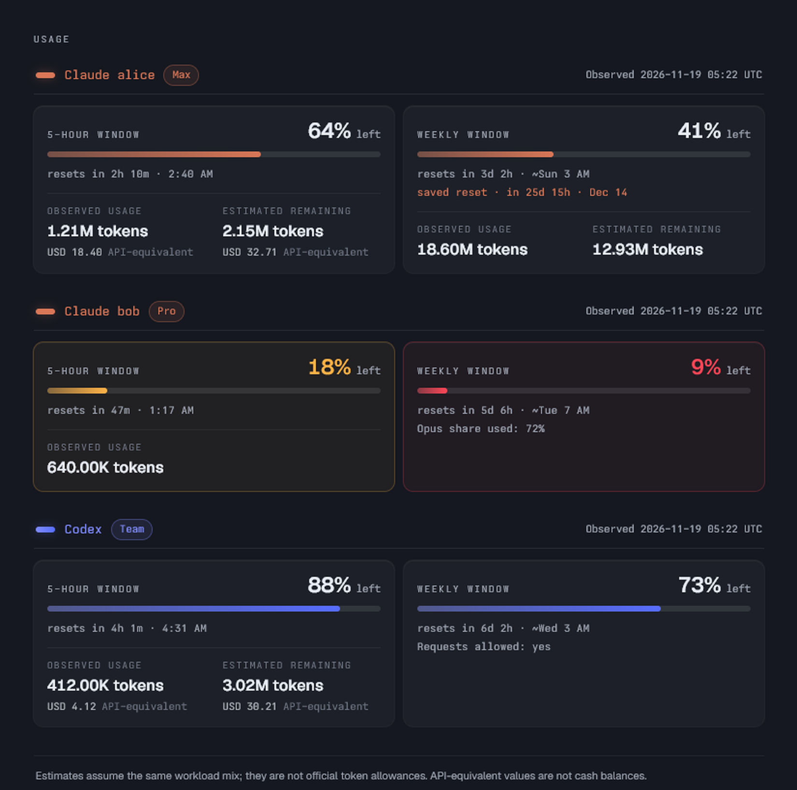

## Settings

Open the panel with **Ctrl+Alt+U** (rebind `plugin.omp-usage.panel`), **Settings** in the quota details, or
**omp Usage: Settings panel** in the palette. Changes apply at once, in every window.

| Section | What it does |
| --- | --- |
| Preview | The line and its card, drawn for the last omp pane you used. Under it, **Card height**: 16 to 50 rows, 26 by default. An estimate under a bar takes a row; everything else Keeper reports is in the quota details |
| Show | **Current model** (default), **All providers** (countdowns move to the card), or **Selected providers**. With no quota data for them, the line shows the focused session's own status |
| Providers | Pick a row up by its grip, then click where it goes; click a window to hide or show it everywhere; the switch adds the provider to Selected. With several accounts, each has its own row: grip, name (click it to show only that account, again for all), windows and a switch that takes it off the line, the card and the quota details. A chip beside the provider says what shows, with a button for the next way: `all 8 accounts` with **combine**, `combined · 10 accounts ✕` with **by plan**, `by plan · 6 with 5H, 4 without ✕` with **all in one**, or `only dev.ops ✕`; by plan, each account's row is tagged with its group (`5H`, `no 5H`) |
| Colors | A preset, a named alternative (Ember, Sunset, Moss, Ocean, Orchid, Slate, Theme accent), or **Custom…** hex colors (`#d97757`, or two: `#9aa7b4, #5b8def`) |
| Updates | Status, **Check for Updates** or **Download Update**, and how often to check (see [Update](#update)) |

External quota sources are set up in a file, not in the panel (see [External quota sources](#external-quota-sources));
their accounts show under Providers like omp's own.

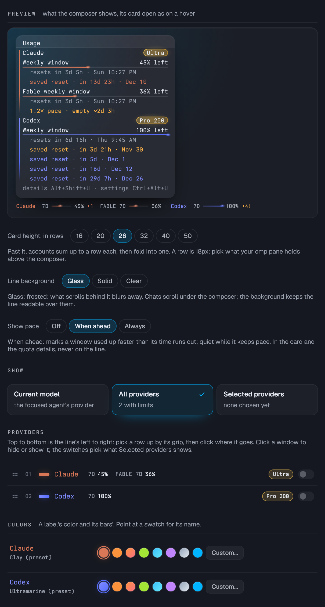

**omp Usage: Settings…** in the palette offers the same as keyboard menus.

**All providers**, one after another; Muse Code's 5-hour window has turned amber:


**Selected providers**, here Codex and Muse while an Opus model is in use:


**Colors**: Claude on Sunset, Codex on a custom `#22d3ee, #a78bfa`:


### Several accounts

Accounts go by the part of their email before the `@`; seats that share it add their domain (`claude-team@lumen`,
`claude-team@pinegg`).

**Ten Claude accounts**, two of them switched off: the line starts with the first account, and the card shows the
first accounts' windows in full as long as it fits in your card height, then sums up each other account in a row;
with still more, the last of those rows fold into one:


In the panel, click an account's name to show only it (click it, or the chip beside the provider, again for all); the
switches take accounts off the line and card:


Then the line has room for all of that account's windows, and the card sums up the others in a row each:


**Combine** shows a provider's accounts as one: each window's share is the average of the accounts that have it,
its reset the soonest, its saved resets all of theirs. A window only some accounts have says how many:

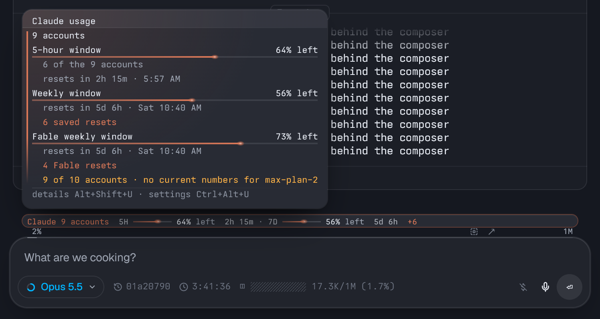

**By plan** keeps the accounts that have the same windows together instead. omp doesn't say which plan an account is
on, so the windows tell them apart: here 6 accounts have a 5-hour window and 4 don't:


In the panel, the chip says how they split, and each account's row says which group it's in:


Combined and by plan average shares only: tokens, costs and estimates are never averaged or added across accounts,
so they show with All accounts or a single account.

To reorder, pick an account (or a provider) up by its grip: it lifts, every place it can go opens, and a click puts it
there. Its grip, now a cross, puts it back:

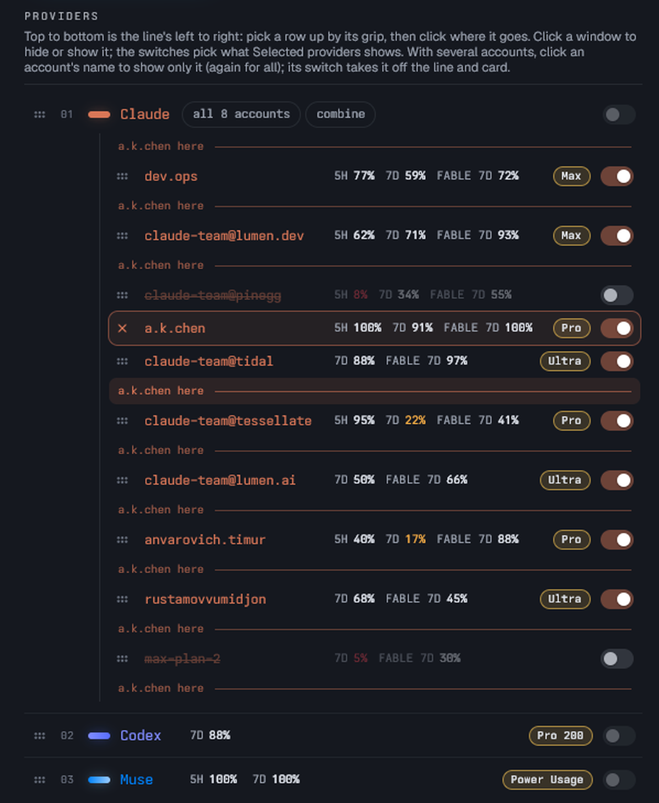

**omp Usage: Settings… › Provider accounts…** does the same from the palette, as keyboard menus:

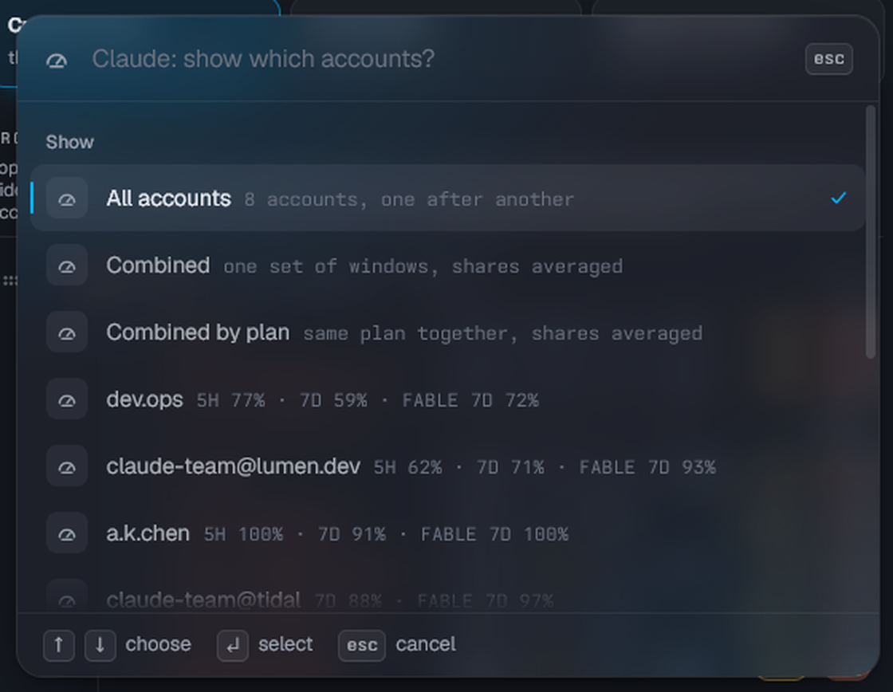

## External quota sources

Besides omp's own accounts, omp Usage can show the accounts behind two proxies, each source as its own provider and
account pool (`Codex@dashboard`):

- **[CLIProxyAPI](https://github.com/router-for-me/CLIProxyAPI)** (CPA): quotas read through its management API,
  with each account's plan.
- **[CPA Usage Keeper](https://github.com/Willxup/cpa-usage-keeper)**: quotas from its cache. Keeper also records the
  requests CPA serves, so for a window with usage it can give the tokens and API-equivalent cost used so far, and
  omp Usage estimates what's left.

Set them up in `~/.omp/agent/usage-sources.json`, then restart omp sessions; nothing changes until that file exists.
The settings, model mappings, what each source can and can't give, and what the views then show are in
[docs/quota-sources.md](docs/quota-sources.md).

## Update

The plugin checks its repo every 6 hours (Hourly, Daily, Weekly or Off in the panel): a clone's remote, or for an
installed copy a copy of the repo it keeps in its data folder. When there's a new version, a toast says so once and
an **Update omp Usage** pill sits in the widget bar until you deal with it:


The pill and **usage** are plugin segments: they show while the widget bar has its **Plugin segments** widget
(palette › Edit widgets…).

Click the pill (or **Check for Updates**) for the update card shown at the top: the version available, the one you
have, and every new commit in full.

| Button | What it does |
| --- | --- |
| **Download Update** | Brings the plugin (and an installed copy's omp extension) up to date and reloads it; the toast says if omp sessions need a restart |
| **Skip This Version** | Hides the pill until a newer plugin change |
| **Not Now** / Esc | Closes the card; the pill stays |

Open settings panels step aside while the update lands, so nothing flashes half-drawn:


When omp's link to the extension has to change (the first time 0.7.0 or later loads after an update, which also
removes the `~/.omp/agent/extensions/usage-remaining.js` loader 0.5.2 to 0.6.x wrote, or after the plugin's folder
moved), it says so:


- Commits that change only the README, its pictures or `.omp/` don't count; they don't light the pill and come along
  with the next real update.
- A merged pull request shows as one entry, its merge.
- It never merges or rebases your work in a clone. With local commits, or edits in the way, update by hand:
  `git pull`, then `tern plugin reload`.
- Clones linked to the deprecated `omp-usage` folder link the repo folder when they update: see
  [From a clone](#from-a-clone).
- Updates need git on `PATH`, installed copies too.
- An installed copy updates from the repo its `upstream` file names, read at each check; a fork puts its own URL
  there. Updates leave that file as you set it.

## Turn it off

| To | Installed | From a clone |
| --- | --- | --- |
| Turn the plugin off | Preferences › Plugins | `tern plugin unlink omp-usage`, or Preferences › Plugins |
| Turn it back on | Preferences › Plugins | `tern plugin link .` from the repo folder |
| Turn the extension off only | `omp plugin disable omp-usage` (or `/extensions` in omp), then restart omp | The same, if you linked it; else delete its line from `~/.omp/agent/config.yml` |
| Remove it | `omp plugin uninstall omp-usage`, then `tern plugin remove omp-usage`, and restart omp | `omp plugin uninstall omp-usage` (or delete the extension's line from `~/.omp/agent/config.yml`), then `tern plugin unlink omp-usage`, and restart omp |

## Troubleshooting

| Symptom | Check |
| --- | --- |
| `tern plugin list` isn't `ready` | It prints the error; Tern's log is `%LOCALAPPDATA%\Tern\Logs\tern.log` |
| No line | Focused pane is omp; its provider has limits; omp restarted after install; extension statuses on (step 2); `omp plugin list` shows `omp-usage` enabled (else **omp Usage: Set up omp extension** in the palette), or `extensions:` in `config.yml` names it |
| `omp Usage couldn't set up its omp extension` | Tern couldn't run `omp plugin`: omp must be on the `PATH` Tern started with. Tern's log has omp's reason and the `omp plugin link …` command to run yourself |
| All/Selected show only the current model, or panes show different numbers | The cache is stale: restart omp sessions |
| The card's reset dates flip between two values | An omp session from before an update is still writing the cache: restart omp sessions |
| Line stopped after an omp or Tern update | omp may have renamed what the plugin reads: ask omp to fix `omp-usage` |
| Clicking the line does nothing | Expected: Tern gives plugins no clicks on omp's composer. Use the shortcuts, or `usage` in the widget bar |
| Shift+Alt+U or Ctrl+Alt+U does nothing | Another binding took it: bind `plugin.omp-usage.details` or `plugin.omp-usage.panel` to another chord |
| No update pill, or no **usage** | Add the **Plugin segments** widget to Tern's widget bar (palette › Edit widgets…), or use the panel's Updates section; checks may be Off |
| `omp Usage can't check for updates` | Needs git on `PATH`; a clone needs a branch tracking a remote, an installed copy its `upstream` file naming the repo (`https://github.com/jmazzola/tern-plugin-omp-usage.git`); the toast gives the reason |
| `omp Usage can't tell which version it is` | The repo its `upstream` file names has no commit at the installed version: a fork puts its own URL in `upstream` |
| `omp Usage couldn't link its repo's root` | A clone linked to the deprecated `omp-usage` folder: run `tern plugin link .` in the repo folder |
| Edits to the plugin's `.luau` files don't show | `tern plugin reload` |

Don't edit Tern's `settings.json` from PowerShell: it adds a BOM and Tern falls back to defaults. For external quota
sources, see [their troubleshooting](docs/quota-sources.md#troubleshooting).

## How it works

The parts, the cache every pane reads, the tests and what it's tested with: [docs/development.md](docs/development.md).
