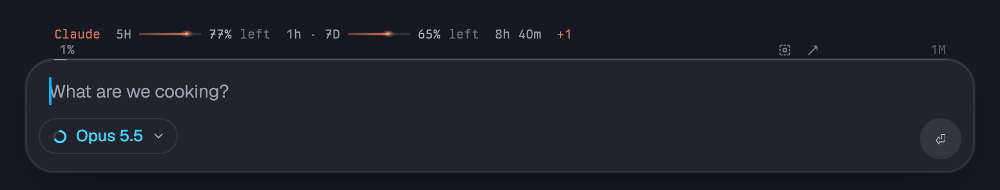
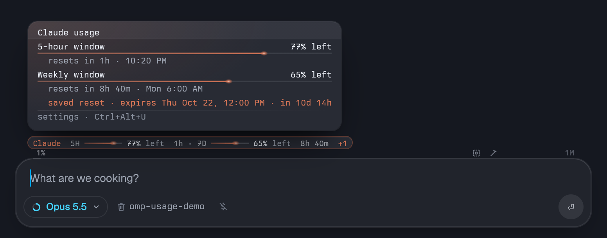
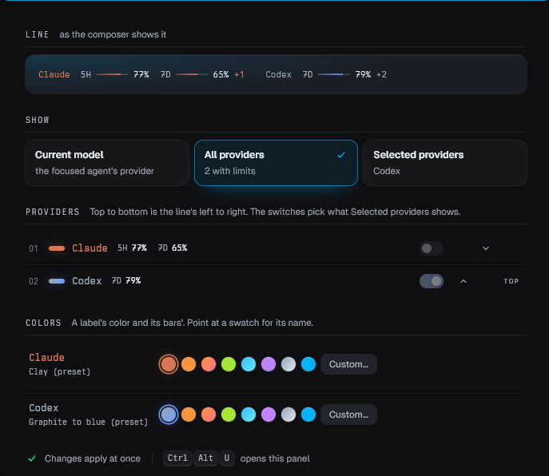
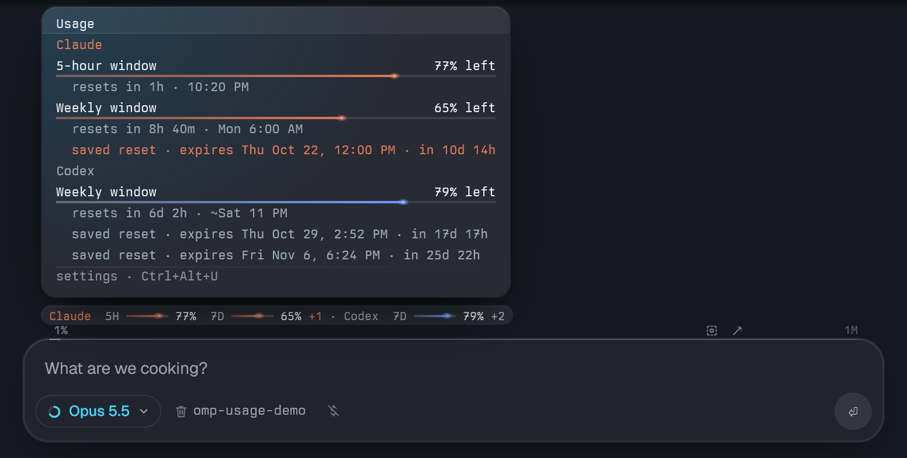
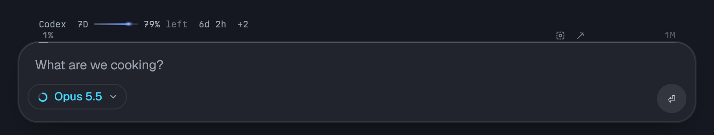
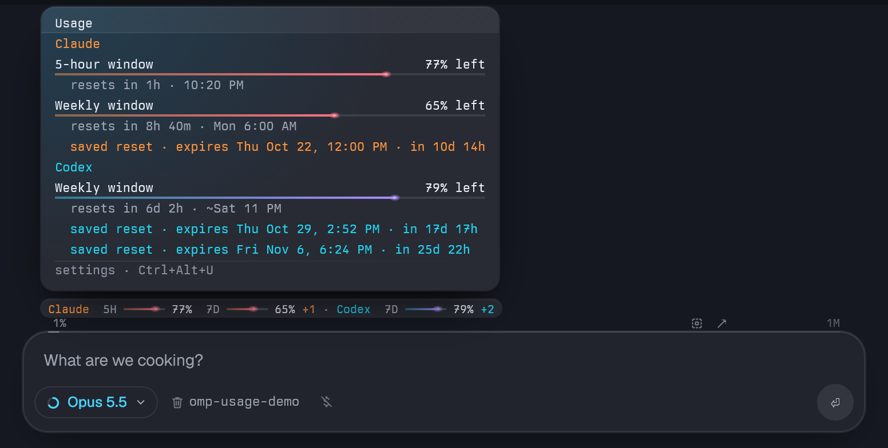

# tern-plugin-omp-usage

Your omp usage limits, shown just above the omp composer's context bar in [Tern](https://stencil.so/tern):



Hover the line for the details: every window's meter, reset countdown and clock time, and when each saved reset
expires.



- Shows the limits for the active model's provider (any provider `omp usage` reports: Claude, Codex, Kimi,
  Gemini, Muse Code, …), and switches within about 2 s when you change models (Alt+P). While you view a subagent's
  transcript, it shows the limits for that subagent's model. Providers and windows come from omp's report, so a
  new provider or an unfamiliar window (labeled by its length, e.g. `2h`) shows without changes here.
- Or shows every provider at once, or the ones you choose, in the order you set (see [Settings](#settings)).
- Each window gets a slim bar filled to the share left, with a lit tip, in its provider's colors: amber at 25%
  or less, red at 10% or less. In a narrow pane, windows that don't fit drop off whole.
- When a share changes, the line prints again and a comet runs each changed bar to its new level: in the
  provider's color when quota drops, green when it comes back.
- Hover the line to lift it into a glass capsule; after a beat a card opens above it with each window, its
  meter, reset countdown and clock time, the expiry date of each saved reset, and the settings shortcut.
- Change what it shows, the providers' order and their colors in a settings panel: Ctrl+Alt+U, or **usage**
  in the status bar.

| Part | What it does |
| --- | --- |
| `omp/extensions/usage-remaining.js` | omp extension. Fetches `omp usage --json`, sets the line as an omp extension status, and writes every model's and provider's line to a cache file. |
| `omp-usage/` | Tern plugin. Reads the focused omp pane's extension statuses and the cache, draws the line above the context bar, hides the statuses in the bar, and adds the settings panel. |

Tested with Tern 0.8.0 and omp 18.9.2 on Windows.

## Requirements

- Tern, with plugins on (Preferences › Plugins).
- omp, signed in to an account with usage limits (Anthropic, OpenAI Codex, …). `omp usage` should list them.

## Install

Run the commands from the folder you cloned into. In paths, prefer forward slashes, even on Windows: they work
in every shell, while unquoted backslashes break in bash-style shells.

### 1. Get the repo

Clone it to a folder you'll keep. Tern and omp load the files from there.

```sh
git clone https://github.com/jmazzola/tern-plugin-omp-usage.git
cd tern-plugin-omp-usage
```

### 2. Link the Tern plugin

```sh
tern plugin link ./omp-usage
tern plugin list
```

`tern plugin list` should show `omp-usage … ready`. The link persists: Tern loads the plugin on every launch.

### 3. Load the omp extension

Add the extension's full path to `~/.omp/agent/config.yml`, or add the line to your existing `extensions:` list.
Replace `/path/to/tern-plugin-omp-usage` with where you cloned it (e.g. `C:/Users/you/tern-plugin-omp-usage`):

```yaml
extensions:
  - /path/to/tern-plugin-omp-usage/omp/extensions/usage-remaining.js
```

### 4. Let omp show extension statuses

The extension's line reaches the composer bar as an extension status, where the plugin reads it (and hides it
from the bar). Either keep `showHookStatus` on, which works with any status line preset:

```yaml
statusLine:
  showHookStatus: true
```

or, with `preset: custom`, list the `status` segment:

```yaml
statusLine:
  leftSegments:
    - status   # alongside your other segments
```

### 5. Restart omp

omp loads extensions when a session starts. Open a new omp pane, or restart open ones.

## Check it works

Click into an omp pane. Within a few seconds the usage line appears above `1% ──── 1M`.

- The line shows on the focused omp pane only.
- A model whose provider has no usage report shows no line.

## Settings

Open the settings panel in any of these ways. It opens beside the focused pane; opening it again goes to the one
that's open.

- Press **Ctrl+Alt+U**. To use another chord, bind `plugin.omp-usage.panel` in Tern's keybinds.
- Click **usage** in the status bar while an omp pane has focus (with the status bar on).
- Run **omp Usage: Settings panel** from the command palette.

| Section | What it does |
| --- | --- |
| Line | Previews the line as the composer shows it, for the last omp pane you used |
| Show | **Current model**: the focused agent's provider (the default); while you view a subagent's transcript, its model's. **All providers**: every provider with limits, one after another; with several, the line drops the countdowns and the word `left` (the card has them). **Selected providers**: the ones switched on under Providers |
| Providers | A row per provider, in the line's order. Its switch puts it in or takes it out of Selected providers, and shows those; its arrows move it one place, **top** moves it first |
| Colors | Per provider: its preset, a named alternative (Ember, Sunset, Moss, Ocean, Orchid, Slate, Theme accent), **Custom…** (one or two hex colors, like `#d97757` or `#9aa7b4, #5b8def`) and **Reset**. Point at a swatch for its name |



Changes apply at once and every Tern window shares them. Tern plugins can't take drag and drop or right-click
menus, so the order is set with buttons.

**omp Usage: Settings…** in the palette offers the same settings as menus, for the keyboard: Open settings
panel…, Show, Choose providers… (the list stays open so you can check several; Esc closes it), Reorder
providers… (pick a provider, then Move up, Move down, Move to top or Move to bottom) and Provider colors….

The presets: Claude clay, Codex graphite to blue, OpenAI green, Kimi green, Gemini blue to white, Antigravity
blue, MiniMax red to pink, Go cyan, Qwen purple, Devin teal. Other providers use the theme's accent. Whatever
a provider's colors, a window at 25% or less turns amber and one at 10% or less red.

### What each choice looks like

**Current model** (the default) shows the focused agent's provider, as at the top of this page.

**All providers** puts every provider with limits on the line, in your order. With several, the line drops the
countdowns and the word `left`; the card has them, grouped by provider:



**Selected providers** shows only the ones switched on, here Codex while an Opus model is in use:



**Colors**: Claude on the Sunset alternative and Codex on a custom `#22d3ee, #a78bfa`:



### The usage cache

After every fetch the extension writes `~/.omp/cache/usage-remaining.json`: each model's line, keyed by the name
omp's model chip shows, each provider's plan-wide line, and the expiry dates of saved resets. The plugin uses it
for a viewed subagent's model, for All and Selected providers, and for the reset dates in the card. It ignores
a cache older than 10 minutes; without a fresh one, every choice falls back to the current model's line. omp
sessions started before the extension wrote the cache need a restart.

## Update

From the repo folder:

```sh
git pull
tern plugin reload
```

Then restart omp sessions if the extension changed.

## Turn it off or uninstall

| To | Do |
| --- | --- |
| Turn the Tern plugin off | `tern plugin unlink omp-usage`, or switch it off in Preferences › Plugins |
| Turn it back on | `tern plugin link ./omp-usage`, from the repo folder |
| Remove the extension | Delete its line from `~/.omp/agent/config.yml`, then restart omp |

## Troubleshooting

| Symptom | Check |
| --- | --- |
| `tern plugin list` doesn't show `ready` | It prints the error. Tern's log on Windows: `%LOCALAPPDATA%\Tern\Logs\tern.log` |
| No line above the context bar | The pane has focus and is omp; the model's provider has limits (`omp usage` lists them); omp was restarted after step 3; extension statuses are on (step 4) |
| All or Selected providers shows only the current model | The cache is missing or older than 10 minutes: restart omp sessions started before the extension was updated |
| Ctrl+Alt+U doesn't open the panel | Another binding or your keyboard layout (where Ctrl+Alt types characters) took it. The hover card's last row shows the chord in effect; bind `plugin.omp-usage.panel` to another in Tern's keybinds |
| Line stopped after an omp or Tern update | omp may have renamed what the plugin reads. Ask omp to fix `omp-usage` |
| Edits to `window.luau` don't show | Run `tern plugin reload` |

Don't edit Tern's `settings.json` from PowerShell. It saves the file with a BOM, and Tern falls back to its
default settings until the file is restored.
