# tern-plugin-omp-usage

Your omp usage limits, right above the omp composer's context bar in [Tern](https://stencil.so/tern):


Tern's widget bar can show stats too, but it lives at the edge of the window. This sits right where you're already
looking while you work: above the composer, every time you glance down, without leaving the session.

In the Spine chat style it sits just under the bar instead, on the composer's column, out of the way of omp's working
status:


Hover it for your plan and each window's meter, reset time and saved resets:


What it does:

- follows your model: the active model's provider (anything `omp usage` reports - Claude, Codex, Kimi, Gemini, Grok,
  Muse Code, …), switching within ~2 s of Alt+P, or a subagent's model while you're viewing its transcript. New
  providers and windows just show up. Or it shows every provider, or only the ones you pick, in your order.
- several accounts on one provider: all of them (`Claude dev.ops 5H … · a.k.chen 5H …`), only the one you pick, or
  combined into one set of windows (all in one, or by plan). Switch any of them off to leave it out.
- reads at a glance: a bar per window in its provider's colors, amber at 25% left, red at 10%. When a share changes,
  a comet runs the bar to its new level. Saved resets show as `+N` (`+NF` for Claude's Fable resets).
- puts what limits you first: on a Fable or Mythos model, the Fable weekly window leads the line
- stays readable: the line sits on a strip of Liquid Glass (or a solid one, or none), so the chat scrolling under the
  composer only shows through it softened
- a hover card that fits: you set how many rows it can take, and past that, accounts sum up instead of running off
  the screen
- each account's plan (`Ultra`, `Pro 200`) on its heading, wherever the provider says which plan it is; switch any of
  them off in the panel
- quota details (Alt+Shift+U): every account and window in full, in a view of its own
- CLIProxyAPI and CPA Usage Keeper, if you use them: their accounts next to omp's own, and from Keeper, the tokens
  and API-equivalent cost each window has used and roughly what's left
- the same numbers in every pane, even though every omp session checks usage on its own clock
- looks how you want: four styles (Instrument, Blocks `▰▰▰▱`, Ring `◔`, Compact text), above the context bar,
  under it, or stacked a row per window at the composer's right or left; pick which parts show, and whether shares
  say what's left or what's used
- a settings panel (Ctrl+Alt+U) for what shows, the order, each provider's windows and colors, and the line's
  background
- installs from Tern and sets up its own omp extension
- updates itself like Tern does: an **Update omp Usage** pill in the widget bar, one click to see what's new and
  install it. Nothing pops up over your work.


## Install

You need Tern with plugins on (Preferences › Plugins), and either omp signed in to an account with limits (`omp
usage` should list them) or an [external quota source](#external-quota-sources).

1. **Install the plugin.** In Tern, go to Preferences › Plugins › Install, enter
   `github.com/jmazzola/tern-plugin-omp-usage` and click **Install**. Or from a terminal:

   ```sh
   tern plugin install github.com/jmazzola/tern-plugin-omp-usage
   ```

   A few seconds later it runs `omp plugin link` on its `omp/` folder, so omp loads the extension as its own plugin,
   `omp-usage`, straight from the plugin's folder. Updates reach omp the same way. Then it tells you:

   

   It runs the `omp` on Tern's `PATH`, or else the omp Tern manages itself. If it can't (usually because neither is
   there), it says that instead, and Tern's log has the reason and the exact command to run:

   

   From then on it's one of omp's plugins: `/extensions` or `omp plugin disable omp-usage` turns it off, `omp plugin
   enable omp-usage` turns it back on. omp Usage leaves the link however you set it. If you `omp plugin uninstall
   omp-usage` and want it back, run **omp Usage: Set up omp extension** from Tern's palette.

2. **Turn on extension statuses** in omp's bar, which is where the plugin reads the line from. Either:

   ```yaml
   # ~/.omp/agent/config.yml
   statusLine:
     showHookStatus: true
   ```

   or, with `preset: custom`, add `status` to `leftSegments`.

3. **Restart your omp sessions.** Click into an omp pane and the line shows up above `1% ──── 1M` (under it in
   Spine) within a few seconds.

### From a clone

To work on the plugin, clone the repo and link it instead, so Tern and omp load the files straight from your clone.
Use forward slashes in paths, even on Windows.

```sh
git clone https://github.com/jmazzola/tern-plugin-omp-usage.git
cd tern-plugin-omp-usage
tern plugin link .
```

Then have omp load the extension from the clone, and do steps 2 and 3 above:

```sh
omp plugin link ./omp
```

Naming `omp/extensions/usage-remaining.js` under `extensions:` in `~/.omp/agent/config.yml` works too. An installed
copy then skips linking its own, so omp never runs it twice.

> [!WARNING]
> **The `omp-usage` folder is deprecated.** Since 0.5.0 the plugin is the repo itself. Clones linked to
> `…/tern-plugin-omp-usage/omp-usage` (the old install) relink to the repo folder on their own when they update to
> 0.5.0, and a toast says so:
>
> 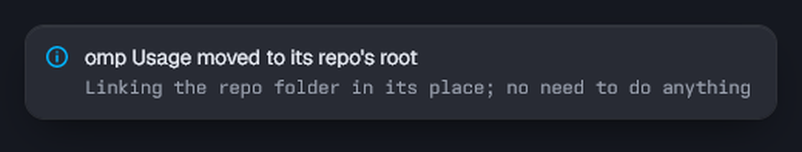
>
> If that fails, a toast tells you where to run `tern plugin link .` yourself:
>
> 
>
> The folder goes away in a later release, and a clone still linked to it stops loading then. `tern plugin list`
> shows which folder yours is using.

## The line and its card

Each provider gets its label, then each window gets its label, a bar filled to the share left, the share, and a
countdown to its reset. Saved resets come after as `+N` (`+NF` for Claude's Fable resets), and any other statuses
omp's extensions set go last.

Windows go shortest first, except while a Fable or Mythos model is active: then the Fable weekly window it draws on
leads, on the line and in the card:

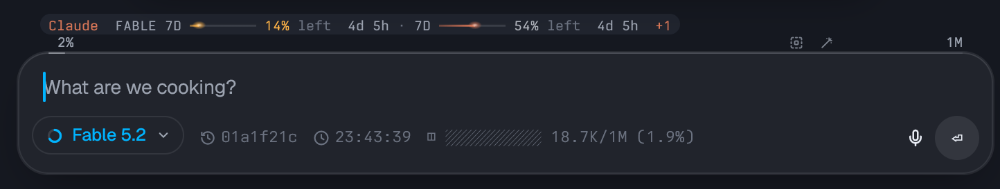

A window at 25% left or less turns amber, and at 10% or less, red. When a share actually changes, the line prints
again while a comet runs the bar to its new level: in the provider's color when quota went down, green when it came
back. With Reduce Motion on (Tern's or the system's), nothing moves.

Tern's chats scroll under the composer, so the line sits on a strip of Liquid Glass: a faint tint with a lit rim and a
sheen, the chat behind it softened and still there.
**Line background** in the panel makes it Solid, or Clear (no background at all). Here's the same moment Clear, then
Glass:

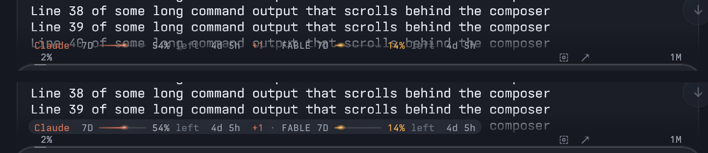

Hover the line and after a beat the card opens: a row and a meter per window, its reset countdown and clock time, then
when each saved reset expires, and the other statuses. The last row names the shortcuts for the quota details and the
settings. The card can take up to the number of rows you set in the panel (26 by default). Past that, accounts sum up
to a row each, and then the last few fold into one (`+4 more accounts · lowest 7D 5%`). With several providers or
accounts, each gets a heading in the title's color, and a bar in its provider's colors down the card's edge beside its
rows (there's a picture under [Settings](#settings)).

Each account's heading carries its plan as a gold pill (the title does, when the card shows a single account),
whenever its provider says which plan it's on. omp reports it for Claude (since omp 19), Codex, Z.ai, Kiro, Gemini
CLI, Muse Code and Copilot, and [CLIProxyAPI and Keeper](#external-quota-sources) report it for their accounts.
Plans read the way they're sold today: what omp calls Claude's `Max 5x` and `Max 20x` show as Max and Ultra, and
Codex's three Pro tiers as Pro 100, Pro 200 and Pro 500.

Where Keeper has an estimate, the tokens and API-equivalent value left go under the window's bar:


Clicking the line does nothing - it's drawn over omp's composer, and Tern doesn't give plugins clicks there. Use the
shortcuts, or `usage` in the widget bar.

## Quota details

Every account and window in full, in a view of its own, with no row limit. Open it with:

- Alt+Shift+U (rebind `plugin.omp-usage.details`)
- `usage` in the widget bar, if you set it to open the quota details (see [Settings](#settings))
- **Quota details** at the end of the settings panel's bottom bar
- **omp Usage: Quota details** in the palette

It opens over the tab. Click outside it or press Esc to close it, or drag its header to keep it around. **Settings**
swaps it for the settings panel (and the panel's **Quota details** swaps right back); **Close** closes it.

Each provider or account gets a heading in its own color, then a box per window, side by side while they fit: the
share, a bar in the line's colors, and its resets and notes. A window running low is ringed amber, and red when it's
nearly empty. It always shows the same providers, accounts and windows as the line.

Each account's heading also gets its plan as a chip when its provider names one. Here are Claude, Codex and Muse
with All providers, Muse's 5-hour window running low:

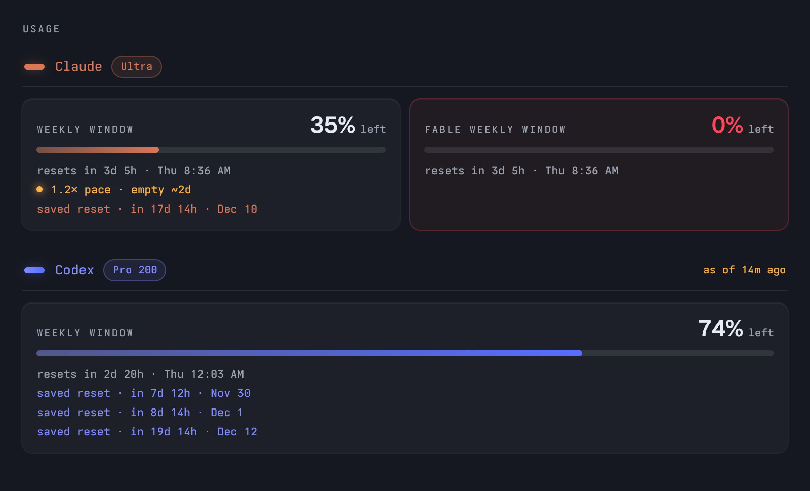

With a [CLIProxyAPI or Keeper](#external-quota-sources) source, the heading also says when the account's numbers
were observed, notes call out a stale or failing source, and windows Keeper has usage for get **Observed usage** and
**Estimated remaining** under the bar. Here it is with sample data shaped like a Keeper source's:


## Settings

Open the panel with:

- Ctrl+Alt+U (rebind `plugin.omp-usage.panel`)
- `usage` in the widget bar, unless you set it to open the quota details instead (**Widget bar** below). Tern only
  shows plugin segments in its **Plugin segments** widget, which you have to place yourself (palette › **Edit
  widgets…**), and `usage` shows there while an omp pane has focus.
- **Settings** in the quota details
- **omp Usage: Settings panel** in the palette

Changes apply right away, in every window.

| Section | What it does |
| --- | --- |
| Preview | The line and its card, drawn for the last omp pane you used. Under it, **Card height**: 16 to 50 rows, 26 by default. An estimate under a bar takes a row; everything else Keeper reports goes in the quota details. Then **Line background**: Glass (default), Solid, or Clear |
| Display | **Style**: Instrument (default), Blocks, Ring or Compact. **Position**: Above the bar (default; in Spine, under it), Under the bar, or Stacked (a block over the chat, a row per window, up to 4; past that the last row sums up the rest), at the composer's **Right** or **Left**. **On the line**: provider, window, bar, share, countdown, saved resets, plan (a gold pill, off by default) and other statuses; a window keeps its bar or its share. **Shares**: Left (default) or Used, on the line, the card and the quota details |
| Show | **Current model** (default), **All providers** (countdowns move to the card), or **Selected providers**. When there's no quota data for them, the line falls back to the focused session's own status |
| Providers | Pick a row up by its grip, then click where it goes. Click a window to hide or show it everywhere. The switch adds the provider to Selected. A provider or account whose plan is known shows it as a gold pill beside its switch: click the pill to leave that plan out of the card and the quota details (it fades and is struck through), again to show it. With several accounts, each one gets its own row: grip, name (click it to show only that account, again for all), windows, plan, and a switch that takes it off the line, the card and the quota details. A chip next to the provider says what's showing, with a button for the next option: `all 8 accounts` with **combine**, `combined · 10 accounts ✕` with **by plan**, `by plan · 2 Max, 4 Pro, 4 Ultra ✕` (or `by plan · 6 with 5H, 4 without ✕`) with **all in one**, or `only dev.ops ✕`. Grouped by windows, each account's row is tagged with its group (`5H`, `no 5H`) |
| Colors | A preset, a named alternative (Ember, Sunset, Moss, Ocean, Orchid, Slate, Theme accent), or **Custom…** hex colors (`#d97757`, or two: `#9aa7b4, #5b8def`). A custom color that's nearly white gets a darker shade in the light theme, and one that's nearly black a lighter one in the dark theme, so it never vanishes into the card |
| Widget bar | What `usage` in the widget bar opens: **Settings panel** (default) or **Quota details** |
| Updates | Status, **Check for Updates** or **Download Update**, and how often to check (see [Update](#update)) |

External quota sources are set up in a file, not the panel (see [External quota sources](#external-quota-sources)).
Their accounts show up under Providers like omp's own.


Prefer the keyboard? **omp Usage: Settings…** in the palette has all the same options as menus.

**All providers**, one after another. Each provider's heading carries its plan, with a bar in its colors beside its
rows:


**Selected providers**, here Codex and Muse while an Opus model is in use:

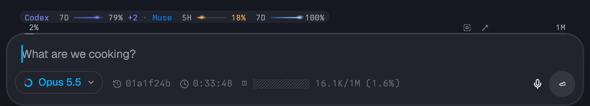

**Colors**, with Claude on Sunset and Codex on a custom `#22d3ee, #a78bfa`:


### Several accounts

Accounts go by the part of their email before the `@`. Seats that share one add their domain (`claude-team@lumen`,
`claude-team@pinegg`).

Here are ten Claude accounts, two of them switched off. The line starts with the first account. The card shows the
first accounts' windows in full for as long as they fit your card height, each under its heading with its plan and a
bar in Claude's colors, then sums up each of the others in a row, and with even more, folds the last of those rows
into one:

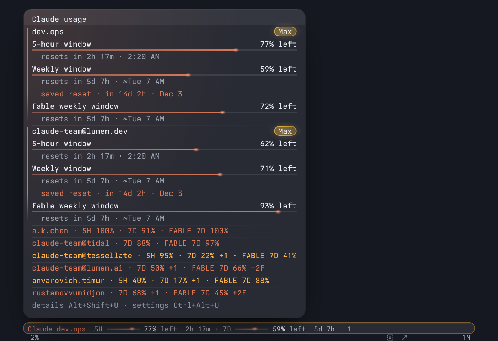

In the panel, click an account's name to show only that one (click it again, or the chip next to the provider, to go
back to all of them). The switches take accounts off the line and the card:

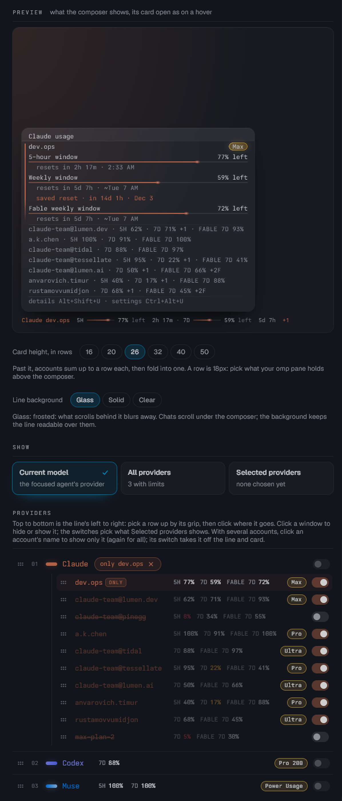

That gives the line room for all of that account's windows, and the card sums up the others in a row each:

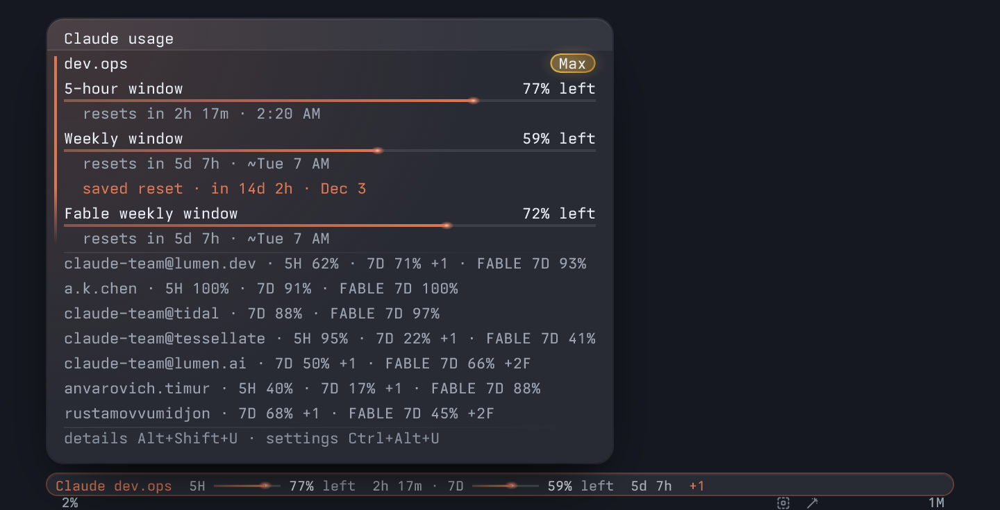

**Combine** shows all of a provider's accounts as one: each window's share is the average of the accounts that have
it, its reset is the soonest one, and its saved resets are all of theirs added up. A window only some of the accounts
have says how many:


**By plan** groups the accounts by the plan their provider says they're on. Here, 2 accounts are on Max, 4 on Pro and
4 on Ultra, which has no 5-hour window:


When any account doesn't name its plan (Kimi and Antigravity never do, nor Claude before omp 19), the accounts with
the same windows go together instead (`6 accounts with a 5-hour window`, `4 accounts without a 5-hour window`).

In the panel, the chip says how they split, and each account's row keeps its plan beside its switch (a row whose
plan is off, or that was grouped by windows, gets a tag with its group instead):


Combining only averages shares. Tokens, costs and estimates are never averaged or added up across accounts (that
would be meaningless across different plans), so they only show with All accounts or a single account picked.

Several providers can each have several accounts. With All providers, every account shown in full gets a heading
naming its provider, its plan, and a bar in its provider's colors; here Codex's second account no longer fits the
card height, so it sums up to one row:

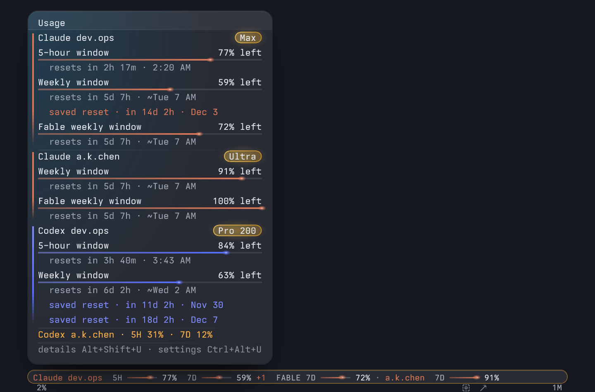

To reorder, pick an account (or a provider) up by its grip. It lifts, every spot it can go opens up, and a click drops
it there. Its grip turns into a cross, which puts it back:


**omp Usage: Settings… › Provider accounts…** does the same thing from the palette, as menus:


## External quota sources

On top of omp's own accounts, omp Usage can show the accounts behind two proxies, each source as its own provider
and account pool (`Codex@dashboard`):

- [CLIProxyAPI](https://github.com/router-for-me/CLIProxyAPI) (CPA): quotas read through its management API, with
  each account's plan
- [CPA Usage Keeper](https://github.com/Willxup/cpa-usage-keeper): quotas from its cache. Keeper also records every
  request CPA serves, so for a window with usage it knows the tokens and API-equivalent cost spent so far, and omp
  Usage estimates what's left from that.

Set them up in `~/.omp/agent/usage-sources.json` and restart your omp sessions. Nothing changes until that file
exists. The settings, model mappings, what each source can and can't give you, and what the views show are all in
[docs/quota-sources.md](docs/quota-sources.md).

## Update

The plugin checks its repo every 6 hours (or Hourly, Daily, Weekly, or Off in the panel): a clone checks its remote,
and an installed copy checks a copy of the repo it keeps in its data folder. When there's a new version, a toast says
so once, and an **Update omp Usage** pill sits in the widget bar until you deal with it:

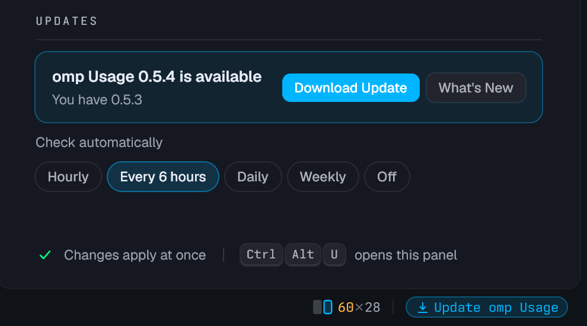

The pill and `usage` are plugin segments, so they only show while the widget bar has its **Plugin segments** widget
(palette › Edit widgets…).

Click the pill (or **Check for Updates**) for the update card at the top of this page: the version that's out, the
one you have, and every new commit in full.

| Button | What it does |
| --- | --- |
| **Download Update** | Brings the plugin (and an installed copy's omp extension) up to date and reloads it. The toast says if omp sessions need a restart |
| **Skip This Version** | Hides the pill until the next plugin change |
| **Not Now** / Esc | Closes the card. The pill stays |

Open settings panels step aside while the update lands, so nothing flashes half-drawn:

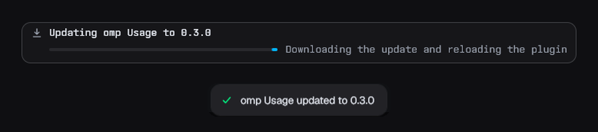

When omp's link to the extension has to change, it tells you. That's the first time 0.7.0 or later loads after an
update (which also deletes the `~/.omp/agent/extensions/usage-remaining.js` loader that 0.5.2 to 0.6.x wrote), or
after the plugin's folder moved:


A few things to know:

- commits that only touch the README, `docs/` or `.omp/` don't count. They don't light the pill, and come along with
  the next real update.
- a merged pull request shows up as one entry (its merge), not every commit in it
- it never merges or rebases your work in a clone. With local commits, or edits in the way, update by hand:
  `git pull`, then `tern plugin reload`.
- clones linked to the deprecated `omp-usage` folder relink to the repo folder when they update (see
  [From a clone](#from-a-clone))
- updates need git on your `PATH`, installed copies included
- an installed copy updates from whatever repo its `upstream` file names, read on every check. A fork puts its own
  URL there, and updates leave that file alone.

## Turn it off

| To | Installed | From a clone |
| --- | --- | --- |
| Turn the plugin off | Preferences › Plugins | `tern plugin unlink omp-usage`, or Preferences › Plugins |
| Turn it back on | Preferences › Plugins | `tern plugin link .` from the repo folder |
| Turn just the extension off | `omp plugin disable omp-usage` (or `/extensions` in omp), then restart omp | The same, if you linked it. Otherwise delete its line from `~/.omp/agent/config.yml` |
| Remove it | `omp plugin uninstall omp-usage`, then `tern plugin remove omp-usage`, and restart omp | `omp plugin uninstall omp-usage` (or delete the extension's line from `~/.omp/agent/config.yml`), then `tern plugin unlink omp-usage`, and restart omp |

## Troubleshooting

| Symptom | Check |
| --- | --- |
| `tern plugin list` isn't `ready` | It prints the error. Tern's log is at `%LOCALAPPDATA%\Tern\Logs\tern.log` |
| No line | The focused pane is omp; its provider has limits; omp was restarted after installing; extension statuses are on (step 2); `omp plugin list` shows `omp-usage` enabled (if not, run **omp Usage: Set up omp extension** from the palette), or `extensions:` in `config.yml` names it |
| `omp Usage couldn't set up its omp extension` | Tern couldn't run `omp plugin`: omp has to be on the `PATH` Tern started with, or be the omp Tern manages. Tern's log has omp's reason and the `omp plugin link …` command to run yourself |
| All/Selected only show the current model, or panes show different numbers | The cache is stale. Restart your omp sessions |
| The card's reset dates flip between two values | An omp session from before an update is still writing the cache. Restart your omp sessions |
| The line stopped after an omp or Tern update | omp may have renamed something the plugin reads. Ask omp to fix `omp-usage` |
| No plan on Claude's heading | omp reports Claude's plan since 19.0. Update omp and restart your omp sessions |
| On a Fable model, the Fable window doesn't lead | An omp session started before you updated omp Usage still runs the old extension. Restart your omp sessions |
| Clicking the line does nothing | That's expected: Tern doesn't give plugins clicks on omp's composer. Use the shortcuts, or `usage` in the widget bar |
| Alt+Shift+U or Ctrl+Alt+U does nothing | Another binding took it. Bind `plugin.omp-usage.details` or `plugin.omp-usage.panel` to something else |
| No update pill, or no `usage` | Add the **Plugin segments** widget to Tern's widget bar (palette › Edit widgets…), or use the panel's Updates section. Checks might also be Off |
| `omp Usage can't check for updates` | It needs git on `PATH`; a clone needs a branch tracking a remote, and an installed copy needs its `upstream` file naming the repo (`https://github.com/jmazzola/tern-plugin-omp-usage.git`). The toast gives the reason |
| `omp Usage can't tell which version it is` | The repo its `upstream` file names has no commit at the installed version. A fork has to put its own URL in `upstream` |
| `omp Usage couldn't link its repo's root` | It's a clone linked to the deprecated `omp-usage` folder. Run `tern plugin link .` in the repo folder |
| Edits to the plugin's `.luau` files don't show | `tern plugin reload` |

Don't edit Tern's `settings.json` from PowerShell: it adds a BOM, and Tern falls back to its defaults. For external
quota sources, see [their troubleshooting](docs/quota-sources.md#troubleshooting).

## How it works

The parts, the cache every pane reads, the tests, and what it's been tested with: [docs/development.md](docs/development.md).
