# tern-plugin-omp-usage

Your omp usage limits, just above the omp composer's context bar in [Tern](https://stencil.so/tern):

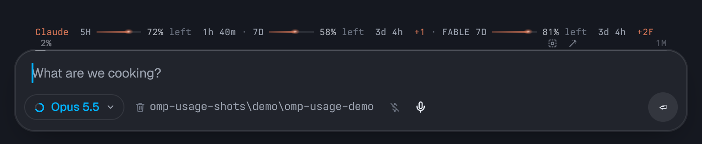

Hover it for each window's meter, reset time and saved resets:

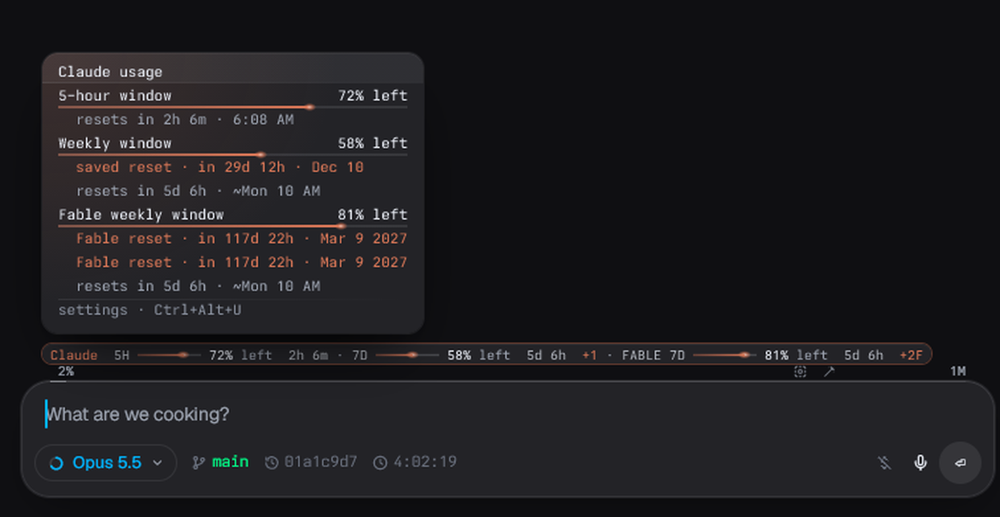

- **Follows your model.** Shows the active model's provider (anything `omp usage` reports: Claude, Codex, Kimi,
  Gemini, Muse Code, …) and switches within ~2 s of Alt+P, or to a subagent's model while you view its transcript.
  New providers and windows show up without changes here.
- **Or every provider**, or the ones you pick, in your order.
- **Several accounts** for one provider: all of them, each named once (`Claude dev.ops 5H … · a.k.chen 5H …`) in
  your order, only the one you pick (the others summed up in the card), or **combined**: one set of windows, each
  window's share their average and their saved resets added up, or **by plan**, the accounts with the same windows
  together. Switch any account off to leave it out. Accounts go by the part of their email before the `@`; seats that share it add their domain
  (`claude-team@lumen`, `claude-team@pinegg`).
- **A card that fits.** You set how many rows it may take (26 by default); past that, accounts sum up to a row
  each, then fold into one (`+4 more accounts · lowest 7D 5%`).
- **Reads at a glance.** Each window gets a bar in its provider's colors, amber at ≤25% left, red at ≤10%. When a
  share changes, a comet runs the bar to its new level. Saved resets show as `+N` (`+NF` for Claude's Fable resets).
- **Settings panel** (Ctrl+Alt+U) for what shows, the order, each provider's windows and colors.
- **Updates itself** like Tern does: an **Update omp Usage** pill in the status line, one click to see what's new
  and install it. Nothing pops up over your work.

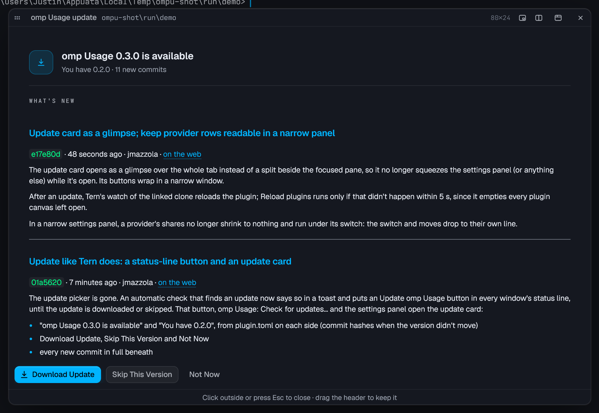

| Part | What it does |
| --- | --- |
| `omp/extensions/usage-remaining.js` | omp extension: fetches `omp usage --json`, sets the line as an extension status, and caches every model's and provider's line. |
| `omp-usage/` | Tern plugin: draws the line above the context bar, hides the statuses it redraws from omp's bar (keeping the session cost), and adds the settings panel and updates. |

Tested with Tern 0.9.14 and omp 18.18.6 on Windows.

## Install

You need Tern with plugins on (Preferences › Plugins) and omp signed in to an account with limits (`omp usage`
should list them). Use forward slashes in paths, even on Windows.

1. **Clone** to a folder you'll keep; Tern and omp load the files from there:

   ```sh
   git clone https://github.com/jmazzola/tern-plugin-omp-usage.git
   cd tern-plugin-omp-usage
   ```

2. **Link the plugin.** `tern plugin list` should show `omp-usage … ready`; Tern loads it on every launch.

   ```sh
   tern plugin link ./omp-usage
   tern plugin list
   ```

3. **Load the extension** in `~/.omp/agent/config.yml`, with your clone's path:

   ```yaml
   extensions:
     - C:/Users/you/tern-plugin-omp-usage/omp/extensions/usage-remaining.js
   ```

4. **Show extension statuses** in omp's bar, where the plugin reads the line. Either:

   ```yaml
   statusLine:
     showHookStatus: true
   ```

   or, with `preset: custom`, add `status` to `leftSegments`.

5. **Restart omp sessions.** Click into an omp pane and the line appears above `1% ──── 1M` within seconds.

## Settings

Open the panel with **Ctrl+Alt+U** (rebind `plugin.omp-usage.panel`), **usage** in the status bar, or **omp Usage:
Settings panel** in the palette. Changes apply at once, in every window.

| Section | What it does |
| --- | --- |
| Preview | The line and its card, drawn as the composer draws them for the last omp pane you used (the line ends where the panel does). Under it, **Card height**: 16 to 50 rows, 26 by default, a row being 18px; a warning says when a card can't fold down to it |
| Show | **Current model** (default), **All providers** (countdowns move to the card), or **Selected providers** |
| Providers | Pick a row up by its grip, then click where it goes; click a window to hide or show it everywhere; the switch adds the provider to Selected. With several accounts, each has its own row: grip, name (click it to show only that account, again for all), windows and a switch that takes it off the line and out of the card. A chip beside the provider says what shows, with a button for the next way: `all 8 accounts` with **combine**, `combined · 10 accounts ✕` with **by plan**, `by plan · 6 with 5H, 4 without ✕` with **all in one**, or `only dev.ops ✕`; by plan, each account's row is tagged with its group (`5H`, `no 5H`) |
| Colors | A preset, a named alternative (Ember, Sunset, Moss, Ocean, Orchid, Slate, Theme accent), or **Custom…** hex colors (`#d97757`, or two: `#9aa7b4, #5b8def`) |
| Updates | Status, **Check for Updates** or **Download Update**, and how often to check (see [Update](#update)) |

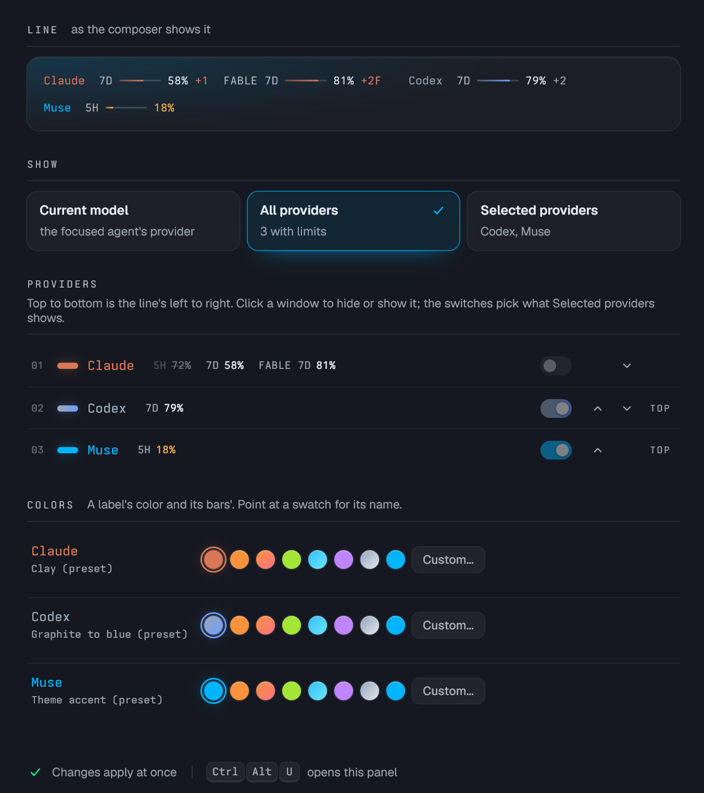

**omp Usage: Settings…** in the palette offers the same as keyboard menus.

**All providers**, one after another; Muse Code's 5-hour window has turned amber:

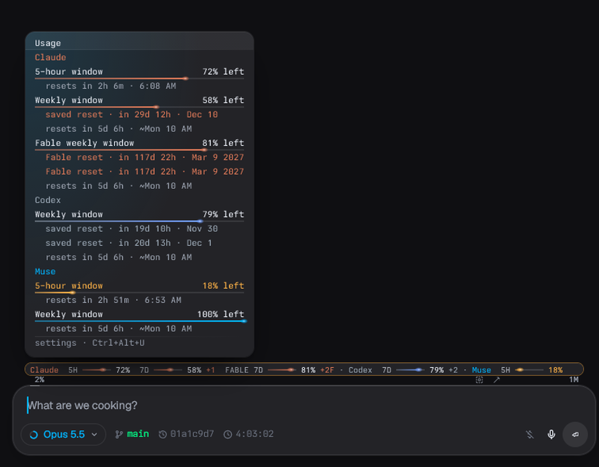

**Selected providers**, here Codex and Muse while an Opus model is in use:

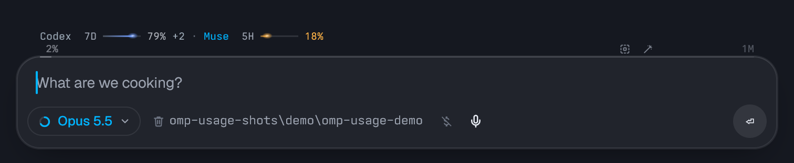

**Colors**: Claude on Sunset, Codex on a custom `#22d3ee, #a78bfa`:

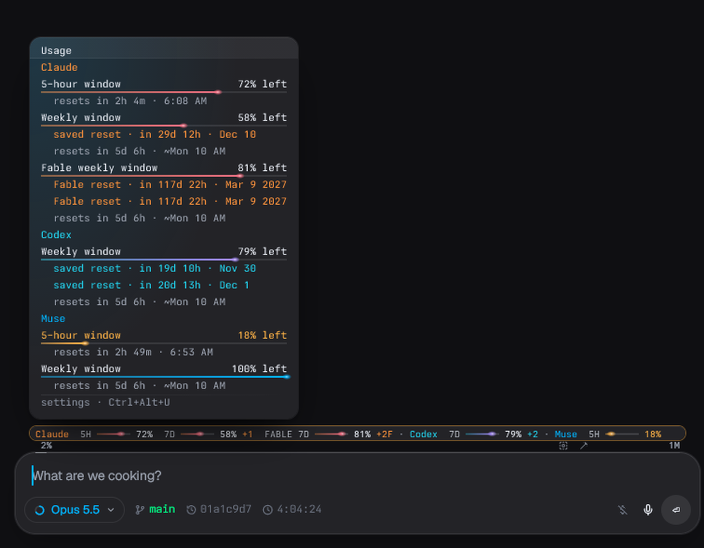

**Ten Claude accounts**, two of them switched off: the line starts with the first account, and the card shows the
first accounts' windows in full as long as it fits in your card height, then sums up each other account in a row;
with still more, the last of those rows fold into one:

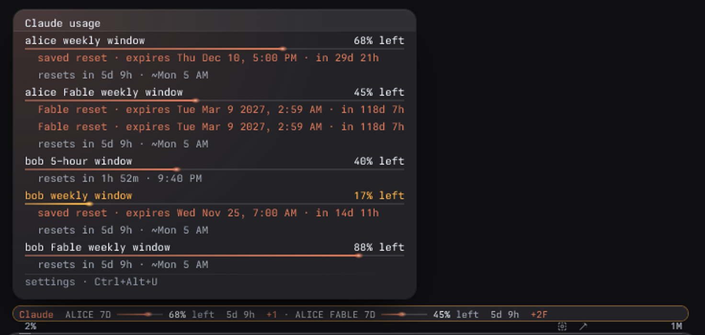

In the panel, click an account's name to show only it (click it, or the chip beside the provider, again for all); the
switches take accounts off the line and card:

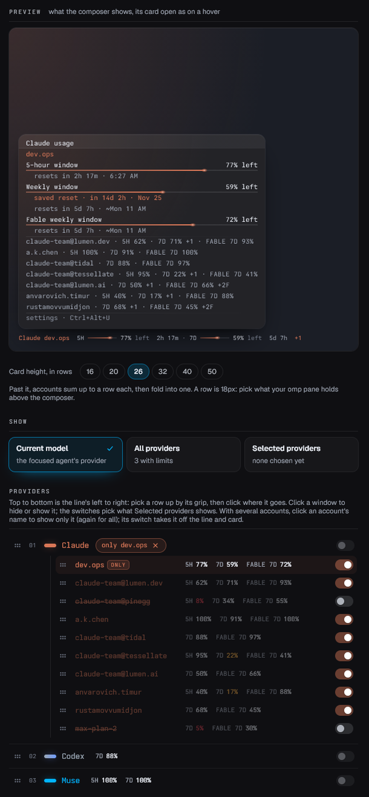

Then the line has room for all of that account's windows, and the card sums up the others in a row each:

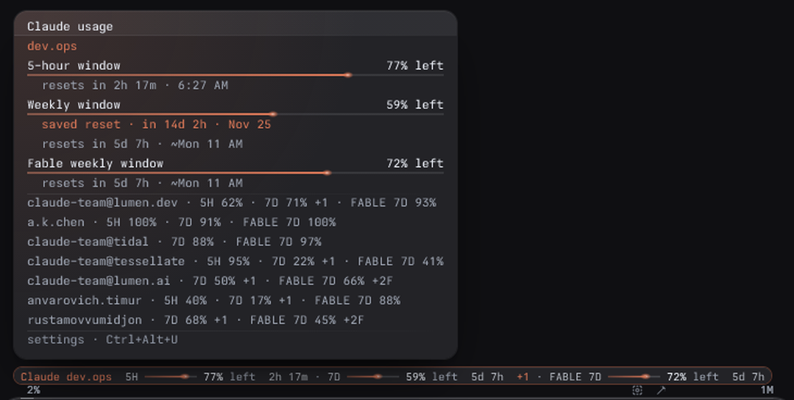

**Combine** shows a provider's accounts as one: each window's share is the average of the accounts that have it,
its reset the soonest, its saved resets all of theirs. A window only some accounts have says how many:

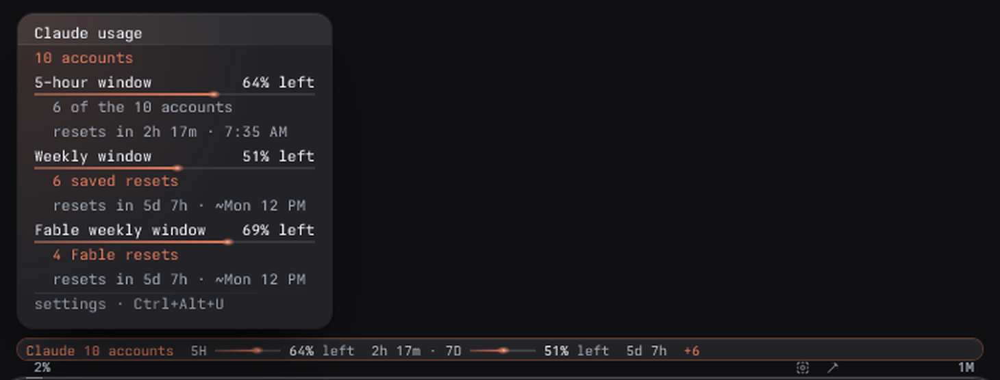

**By plan** keeps the accounts that have the same windows together instead. omp doesn't say which plan an account is
on, so the windows tell them apart: here 6 accounts have a 5-hour window and 4 don't:

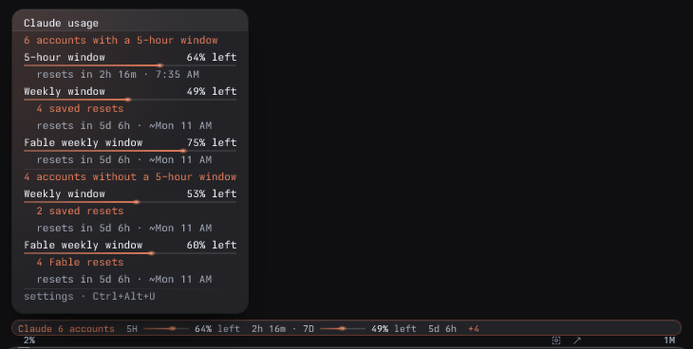

In the panel, the chip says how they split, and each account's row says which group it's in:

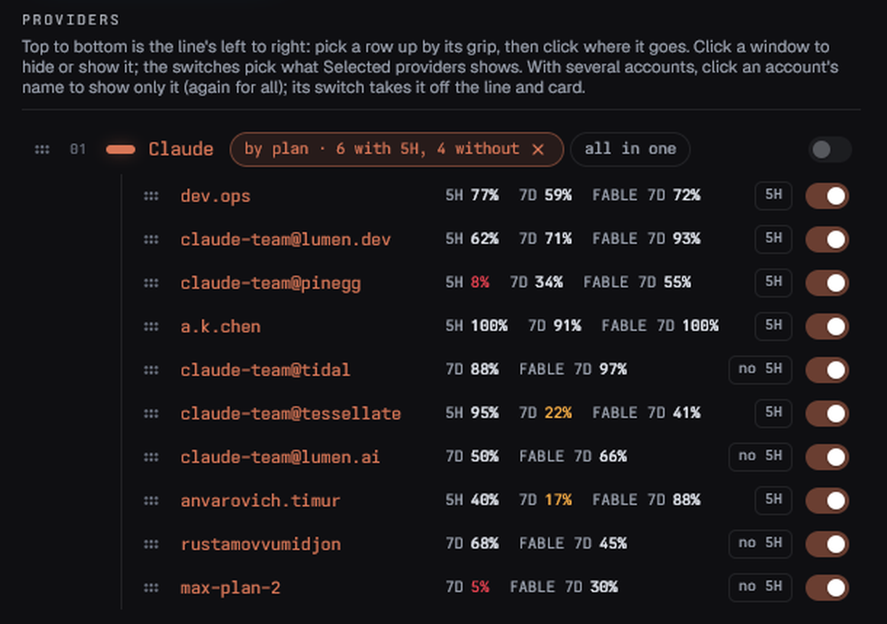

To reorder, pick an account (or a provider) up by its grip: it lifts, every place it can go opens, and a click puts it
there. Its grip, now a cross, puts it back:

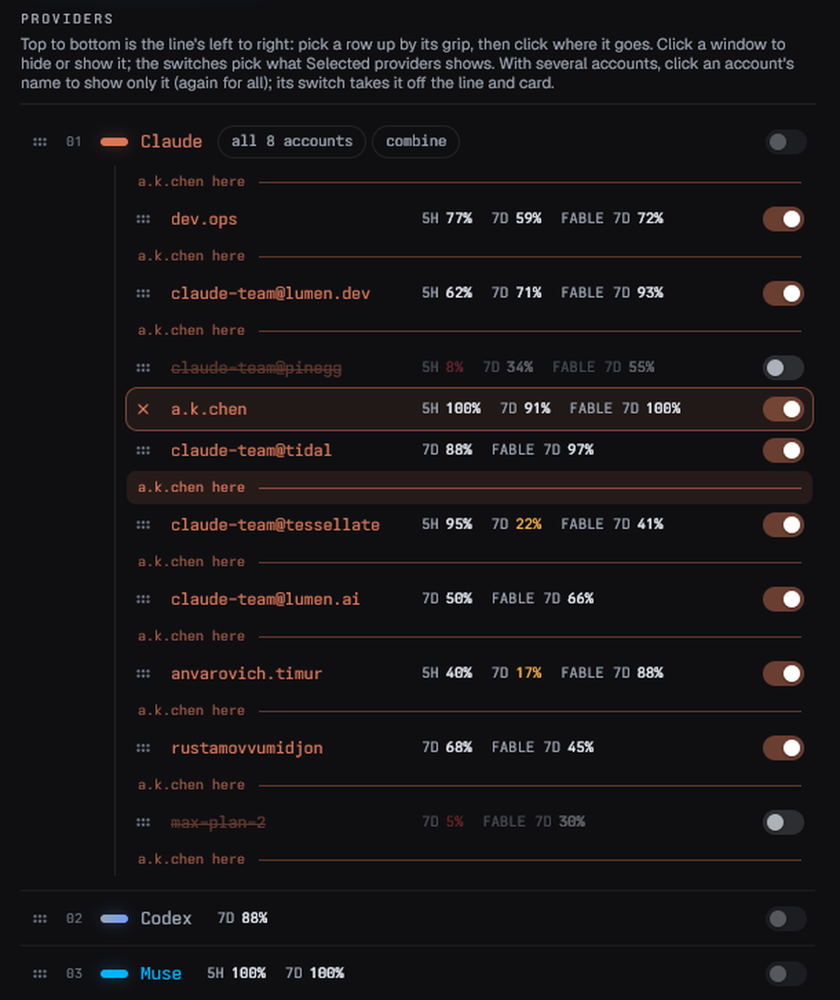

**omp Usage: Settings… › Provider accounts…** does the same from the palette, as keyboard menus:

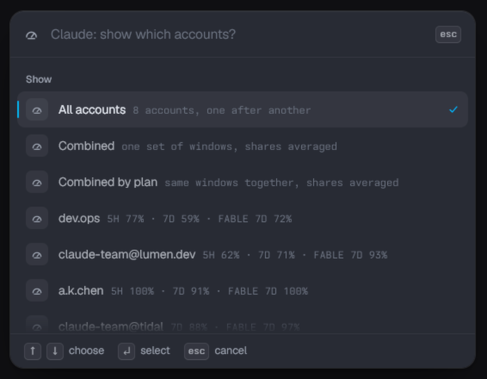

The extension caches every line in `~/.omp/cache/usage-remaining.json`. All and Selected providers, subagent
models, accounts and the card's reset dates read it; a cache older than 10 minutes is ignored.

## Update

The plugin checks your clone's remote every 6 hours (Hourly, Daily, Weekly or Off in the panel). When there's a new
version, a toast says so once and an **Update omp Usage** pill sits in the status line until you deal with it:

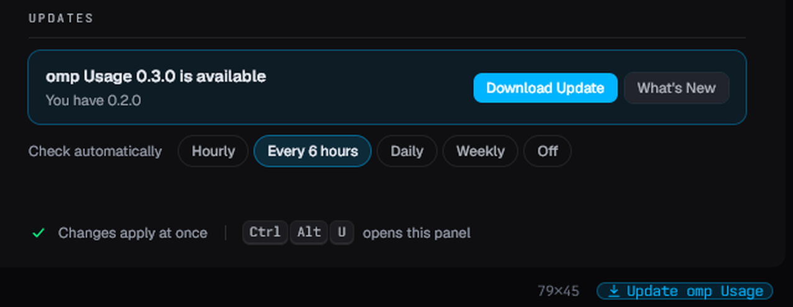

Click it (or **Check for Updates**) for the update card shown at the top: the version available, the one you have,
and every new commit in full.

| Button | What it does |
| --- | --- |
| **Download Update** | Fast-forwards the clone and reloads the plugin; the toast says if omp sessions need a restart |
| **Skip This Version** | Hides the pill until a newer plugin change |
| **Not Now** / Esc | Closes the card; the pill stays |

Open settings panels step aside while the update lands, so nothing flashes half-drawn:

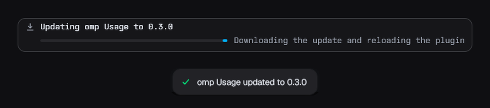

- Only commits that change `omp-usage/` or `omp/` count; README-only pushes don't light the pill and come along with
  the next real update.
- It never merges or rebases your work. With local commits, or edits in the way, update by hand:
  `git pull`, then `tern plugin reload`.

## Turn it off

| To | Do |
| --- | --- |
| Turn the plugin off | `tern plugin unlink omp-usage`, or Preferences › Plugins |
| Turn it back on | `tern plugin link ./omp-usage` from the repo folder |
| Remove the extension | Delete its line from `~/.omp/agent/config.yml`, then restart omp |

## Troubleshooting

| Symptom | Check |
| --- | --- |
| `tern plugin list` isn't `ready` | It prints the error; Tern's log is `%LOCALAPPDATA%\Tern\Logs\tern.log` |
| No line | Focused pane is omp; its provider has limits; omp restarted after install; extension statuses on (step 4) |
| All/Selected show only the current model | The cache is stale: restart omp sessions |
| Ctrl+Alt+U does nothing | Another binding took it; bind `plugin.omp-usage.panel` to another chord |
| Line stopped after an omp or Tern update | omp may have renamed what the plugin reads: ask omp to fix `omp-usage` |
| No update pill | Turn Tern's status bar on, or use the panel's Updates section; checks may be Off |
| `omp Usage can't check for updates` | Needs a git clone tracking a remote, and git on `PATH`; the toast shows git's reason |
| Edits to `window.luau` don't show | `tern plugin reload` |

Don't edit Tern's `settings.json` from PowerShell: it adds a BOM and Tern falls back to defaults.
